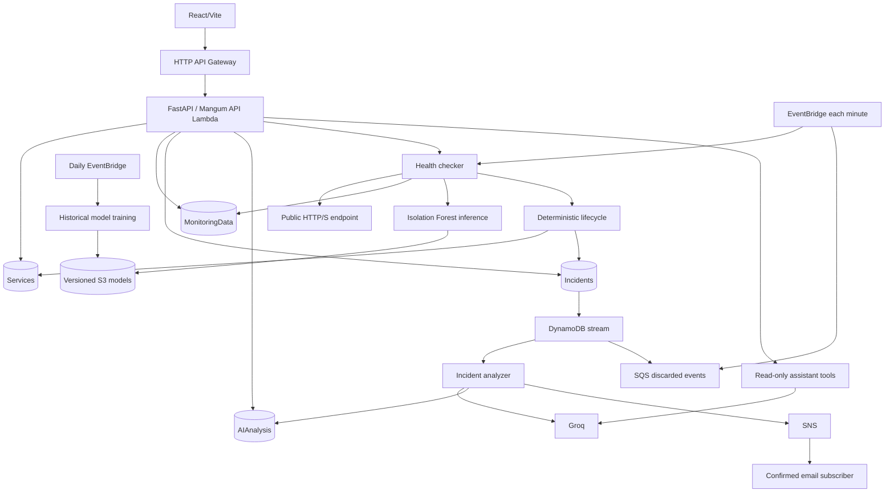
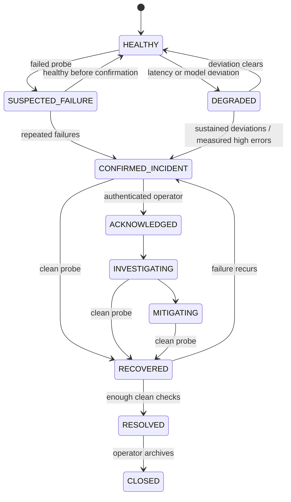

# ISMS architecture

The before-change audit is in AUDIT.md. This describes implemented behavior.

Services retain registration settings, dependencies, SLO targets, latest lifecycle state, consecutive counts, last successful/failed checks, active incident pointer and a versioned concurrency lease. MonitoringData uses service ID + timestamp and a retention TTL. Incidents retain snapshots, severity/detector provenance, acknowledgement, timeline, notification attempts and downtime. AIAnalysis retains structured investigations and their evidence/provider/status. Data conversion is recursive and DynamoDB writes use Decimal values.

The local JSON adapter was fundamentally inconsistent with DynamoDB and swallowed write errors. It is replaced by an explicitly selected SQLite adapter with atomic conditional writes. The original JSON file is preserved. AWS clients use bounded timeouts and standard backoff; production initialization/storage errors propagate as platform failures.

The same canonical check runs on manual and scheduled invocation. It acquires a per-service lease, validates/resolves/pins the target, performs the probe, loads the bounded prior baseline, optionally runs ML, persists telemetry and processes the lifecycle. ML errors cannot skip deterministic failure detection. Replay timestamps are ignored. Versioned conditional writes reject concurrent updates; a consistent service incident pointer avoids relying only on eventually consistent indexes. Scheduled replays skip services not due for another check. Function budget checks leave unchecked services due for subsequent invocation.

Observed service state and operator incident state are related but separate: acknowledgement does not make a service healthy. Downtime begins with the observed failure episode, ends with verified resolution, and is bounded by probe cadence. Sustained error-rate detection uses recent probe windows; it does not infer application traffic error rates.

A dedicated incident stream worker performs notification and AI work asynchronously. It uses an incident processing lease and ignores lease/AI-only stream updates. Failed stream processing is retried and discarded records go to SQS. SNS creation is independent of provider availability. No extra incident is created while the active incident remains unresolved. Local mode invokes the same worker directly after checks.

The previous untriggered detector Lambda is retained as a daily historical training worker. Versioned S3 artifacts make trained models available to API and checker cold starts. Model promotion happens after validation/serialization/upload. See ML.md for statistical limits and retraining policy.

Dependency correlation is graph traversal over declared relationships plus observed incidents/metrics. It cannot prove causal direction without supporting application evidence. Logs and deployment events are marked unavailable because no ingestion path for those sources is implemented.

Security: generated administrator secret, exact configured CORS origins, public-address probe validation and pinned resolution, default TLS validation, read-only assistant retrieval and fixed runbooks. IAM limits operations to the specific tables, indexes, bucket, secrets and topic used by each function. Shared administrator identity is appropriate for a small demo; individual SSO/RBAC is not implemented.

Operational cost controls: one-minute polling with due filtering, daily retraining, on-demand DynamoDB, telemetry TTL, fourteen-day logs, bounded context and one investigation per new incident. CloudWatch monitors Lambda errors and structured platform failure events, and alarms on retained failed events. The original project has no managed frontend hosting resource; deploy its Vite build to an appropriate existing static host or run it locally against the cloud API.

References: [SAM DynamoDB stream configuration](https://docs.aws.amazon.com/serverless-application-model/latest/developerguide/sam-property-function-dynamodb.html), [SAM custom dependency-layer builds](https://docs.aws.amazon.com/serverless-application-model/latest/developerguide/building-layers.html), [EventBridge delivery failure configuration](https://docs.aws.amazon.com/serverless-application-model/latest/developerguide/sam-property-function-scheduledeadletterconfig.html).
