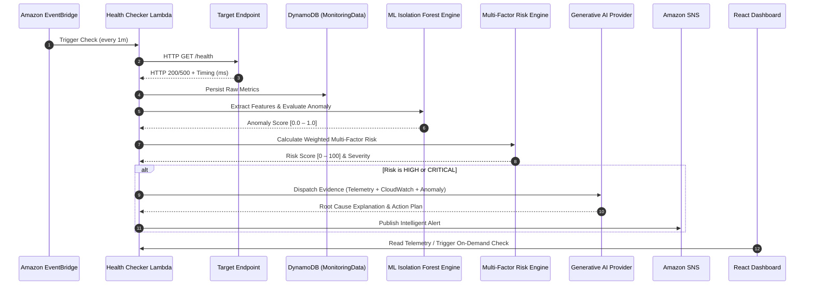

# System Architecture & Technical Specifications

## 1. System Data Flow

## 2. Multi-Factor Risk Scoring Formula

The Risk Engine computes a composite score $S \in [0, 100]$ as follows:

$$S = \sum_{i=1}^{5} w_i \cdot f_i$$

Where:
- $w_1 = 0.25$ (Response time vs. static threshold breach ratio)
- $w_2 = 0.15$ (Latency deviation from historical moving average $\mu + 2\sigma$)
- $w_3 = 0.25$ (Error rate percentage $0.0 \to 1.0$)
- $w_4 = 0.20$ (Availability binary failure penalty)
- $w_5 = 0.15$ (Isolation Forest outlier anomaly score)

### Severity Classification:
- **LOW**: $S < 30$
- **MEDIUM**: $30 \le S < 60$
- **HIGH**: $60 \le S < 80$
- **CRITICAL**: $S \ge 80$

## 3. DynamoDB Data Models

### `Services` Table
- **Partition Key**: `service_id` (String UUID)
- **Attributes**: `service_name`, `url`, `http_method`, `expected_status_code`, `check_interval`, `timeout`, `response_time_threshold`, `error_threshold`, `is_active`, `tags`, `created_at`, `updated_at`

### `MonitoringData` Table
- **Partition Key**: `service_id` (String UUID)
- **Sort Key**: `timestamp` (ISO 8601 UTC String)
- **Attributes**: `status_code`, `response_time`, `availability`, `error`, `error_rate`, `timeout`, `request_success`, `ttl`

### `Incidents` Table
- **Partition Key**: `incident_id` (String `inc-{timestamp}`)
- **GSI (`ServiceIndex`)**: PK `service_id`, SK `created_at`
- **Attributes**: `severity`, `status`, `trigger_reason`, `anomaly_score`, `risk_score`, `risk_level`, `metrics_snapshot`, `resolved_at`, `resolution_notes`

### `AIAnalysis` Table
- **Partition Key**: `analysis_id` (String `ai-{timestamp}`)
- **GSI (`IncidentIndex`)**: PK `incident_id`, SK `timestamp`
- **GSI (`ServiceIndex`)**: PK `service_id`, SK `timestamp`
- **Attributes**: `incident_summary`, `observed_facts`, `possible_causes`, `impact`, `recommended_actions`, `confidence`, `risk_level`, `risk_score`
