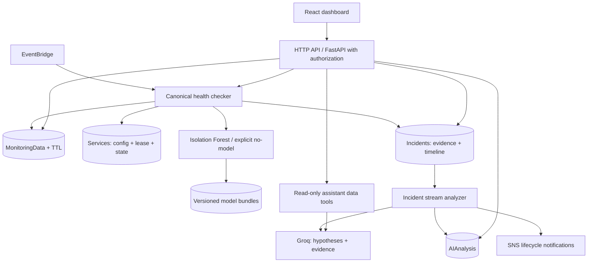

# Existing-system audit — 2026-11-09

This records the implementation before the upgrade. README claims were not treated as verification. Every tracked source, test, manifest and infrastructure file was inspected. Existing user changes in README, PROJECT_GUIDE, config and requirements were preserved.

## Execution map

React App polls overview/services/incidents every 15 seconds. Modals register services, query history, retrain, analyze and chat through `src/services/api.js`. Vite proxies `/api` to FastAPI on 8001; deployed builds have no configurable API origin. There is no authentication. Fetch failures become empty lists. Incident drawer does not fetch persisted analysis on opening. Charts label HTTP errors as ML anomalies.

API Gateway HTTP proxy -> Mangum -> FastAPI routes -> four DynamoDB repositories. Development selects a JSON file adapter. Production can silently select that adapter on AWS initialization failure. Its primary-key selection, conditions, filtering and update expressions differ from DynamoDB. No repository provides reliable concurrency control.

| Lambda | Trigger / inputs | Execution and downstream effects | Finding |
|---|---|---|---|
| HealthChecker | EventBridge every minute; ignores event body | Scans active services, sequential urllib probes, metric write, local training, inference, risk, incident, inline Groq, SNS | Connected; ignores service intervals; whole invocation 30s; exceptions return HTTP-style success to scheduler |
| AnomalyDetector | None in SAM; direct/stream-shaped events accepted in code | Reads services/history, predicts, logs anomaly | Deployed but uninvoked; does not persist results or create incidents |
| IncidentAnalyzer | None in SAM; incident IDs | Reads incident/latest/history, invokes provider, writes AI table | Deployed but uninvoked; missing service read permissions for richer context |
| API | HTTP API `ANY /` and `ANY /{proxy+}` | Service CRUD, manual probe, incident triage, AI, retrain | Public administrative operations |

## Feature classification

| Category | Verified implementation / gap |
|---|---|
| Working in code | Service CRUD route wiring; actual urllib HTTP probes with default TLS verification; real Groq OpenAI-compatible client; IsolationForest fit/predict; risk calculation; structured JSON logging; local periodic monitoring |
| Partially working | Dedup uses eventually consistent GSI scan of last five incidents; single-success recovery; SNS publishes only during creation; chat retrieves latest samples and 20 incidents; training persists only local files; telemetry time-range queries return one page |
| Broken | PATCH incident passes nonexistent `resolution_notes` parameter; monitoring history without hours calls nonexistent method; AI list calls nonexistent aliases; local boto conditions are never evaluated; JSON adapter can overwrite incidents with same service ID; existing outage can resolve on low risk after dedup returns false |
| Mocked | Retrain fabricates 25 baseline samples in actual monitoring storage; mock provider invents facts; seed script inserts fictional AI/model claims and unreachable example services |
| Missing | Failure/success hysteresis; downtime and incident timeline; acknowledge audit; escalation/recovery history; dependencies/correlation; SLO; controlled remediation; actual failure demo; platform alarms; auth; cloud ML artifacts/version/evaluation; CI/deployment automation |
| Misconfigured | Region defaults us-east-1 instead of ap-south-2; wildcard credentialed CORS ignores settings; JWT settings unused; SNS no subscription; TTL enabled in SAM but never written; tracing enabled but no platform alarms/log retention; same global Groq key exposed to every function |
| Unused / duplicated | Untriggered standalone detector/analyzer; unused validators/imports; duplicate Decimal conversion; unsupported provider mock; stale empty-repository plan; documentation formulas disagree with risk implementation |

## AI and ML evidence

Groq is selected explicitly with model from settings. Provider errors are sanitized, but SDK default timeouts exceed Lambda/API budgets. JSON mode is parsed with permissive missing-field defaults. Incident context contains only current sample, aggregate means and optional logs (no caller gathers logs); prompts separate possible causes from facts. Fallback guesses causes but is not machine inference. Chat cannot substantiate daily/week counts or latency trends from latest samples alone.

Training uses historical observations after very weak validation, 20-sample minimum, ten features, rolling means and fixed seed. Files in Lambda `/tmp` are neither shared nor durable. No held-out evaluation, version or deployment pointer exists. Inference skips if no model, reports zero score; model errors can abort deterministic incident handling. Historical query is newest-first; `[-20:]` picks old observations. Current sample already persisted before history retrieval contaminates baseline and can duplicate inference inputs.

## AWS and security

SAM provisions HTTP API, four on-demand DynamoDB tables, four functions, one schedule and one SNS topic. No S3 model store, email subscription, failure destination, alarms or explicit log retention. CRUD policies are broader than individual operations need. No secrets were printed during inspection. Existing `.env` and local database were not dumped or overwritten. Baseline test command failed at collection: default Python 3.14 has no FastAPI/pydantic-settings/numpy installed; this is an environment failure, not a passing suite.

## Target architecture

Keep React/Vite, API Gateway/FastAPI, DynamoDB, EventBridge and SNS. One canonical probe and deterministic lifecycle runs for both manual and scheduled checks; ML is optional evidence and cannot prevent outage detection. Use conditional service leases and consistent active incident pointers to serialize checks. Store observations with TTL and inference provenance. Stream incident lifecycle changes to the analyzer for bounded Groq investigation and notification retry, with a failure destination. S3 stores immutable versioned model bundles and an atomic active pointer. SNS subscription is parameterized; delivery is only verified after confirmation and a real cloud test. Protect API operations with an administrator bearer credential; use a secret reference for cloud credentials. Add a separate controlled HTTPS demo endpoint. No arbitrary execution or LLM action dispatch.

Verification will distinguish automated local evidence from live AWS/Groq/SNS evidence. Deployment and cloud acceptance remain unverified until executed successfully.
