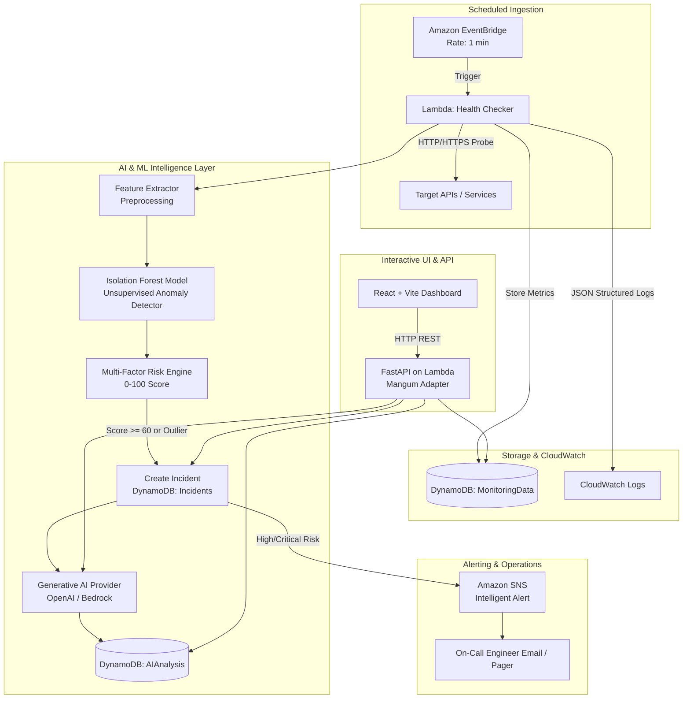

# Complete Project Guide: Intelligent Serverless Monitoring System

---

## 1. Executive Summary & Problem Statement

### 1.1 The Traditional Monitoring Problem
Traditional serverless and cloud monitoring solutions (such as basic CloudWatch Alarms, UptimeRobot, or Pingdom) rely on **static threshold rules** (e.g., alert if HTTP status is 500 or latency > 2000ms).

This legacy paradigm suffers from three critical limitations:
1. **Alert Fatigue & Noise**: Temporary network fluctuations trigger false positives, waking on-call engineers for non-actionable spikes.
2. **Delayed Detection of Subtle Degradation**: Micro-outages, gradual memory leaks, connection pool exhaustion, and intermittent jitter often hover just below static thresholds until a catastrophic cascading failure occurs.
3. **Lack of Explainability & Context**: Traditional alerts deliver raw error codes (`HTTP 504 Gateway Timeout`) with zero context. Engineers must manually search through thousands of raw CloudWatch log streams to deduce what went wrong.

---

### 1.2 The Intelligent Monitoring Solution
The **Intelligent Serverless Monitoring System** preserves the lightweight efficiency of the AWS serverless paradigm (**EventBridge → Lambda → DynamoDB → CloudWatch → SNS**) while augmenting it with an **Intelligent AI Layer**:

* **Unsupervised Anomaly Detection (Isolation Forest)**: Learns multi-dimensional distributions of response times, jitter, status codes, and error ratios without needing labeled failure data.
* **Multi-Factor Risk Scoring Engine (0–100)**: Combines statistical deviation, threshold breach ratios, and ML anomaly scores into a single actionable risk index.
* **Generative AI Root-Cause Explainability**: Evaluates raw telemetry and log evidence to output an Executive Incident Summary, Observed Telemetry Facts, Probable Architectural Root Causes, and Actionable Remediation Steps.
* **Interactive SRE Assistant**: Allows engineers to converse with an AI agent with full context over active telemetry and historical incidents.

---

## 2. System Architecture & End-to-End Workflow



### 2.1 Detailed Execution Steps

1. **Trigger**: Amazon EventBridge schedules the `HealthChecker` Lambda once per minute.
2. **Probing**: For every active service in the `Services` DynamoDB table, an asynchronous HTTP probe is dispatched, measuring exact response time, status code, and payload availability.
3. **Storage**: Telemetry records are saved to the `MonitoringData` DynamoDB table (with TTL for automatic data lifecycle management).
4. **ML Anomaly Scoring**: The `IsolationForest` model evaluates the record against historical baseline features:
   - Base metrics: latency, error rate, availability, normalized status code.
   - Derived metrics: rolling average response time, rolling error rate, change ratio vs. 20-sample historical window.
5. **Composite Risk Calculation**: The Multi-Factor Risk Engine calculates:
   $$\text{Risk Score} = 0.25(\text{Threshold Breach}) + 0.15(\text{StdDev Deviation}) + 0.25(\text{Error Rate}) + 0.20(\text{Outage Penalty}) + 0.15(\text{Anomaly Score})$$
6. **Incident Creation & AI Analysis**:
   - If risk is `HIGH` or `CRITICAL`, an incident is recorded in DynamoDB.
   - The Generative AI layer evaluates the telemetry evidence and generates a structured root-cause diagnosis.
7. **Intelligent Alert**: Amazon SNS dispatches an alert email containing both telemetry metrics and the AI's step-by-step remediation guide.
8. **Dashboard Visualization**: Operators inspect real-time latency graphs, trigger on-demand probes, chat with the AI SRE Assistant, and resolve incidents.

---

## 3. How to Use the Project (Local Development)

### 3.1 Prerequisites
- **Python 3.10+**
- **Node.js 18+ & npm**
- *(Optional)* AWS CLI & AWS SAM CLI for cloud deployment

---

### 3.2 Step 1: Clone and Configure Environment

```bash
git clone <your-repo-url>
cd serverless_event

# Create your local environment file
cp .env.example .env
```

Configuration in `.env`:
```ini
# AWS Region & Environment
AWS_REGION=us-east-1
ENVIRONMENT=development

# AI Provider (Groq; get a key from https://console.groq.com/keys)
AI_PROVIDER=groq
GROQ_API_KEY=your-groq-api-key
GROQ_MODEL=openai/gpt-oss-120b
```

The assistant calls Groq directly through its OpenAI-compatible API using `openai/gpt-oss-120b`, and grounds answers in the service, telemetry, and incident context supplied by the application. It declines unrelated questions and reports missing provider configuration instead of substituting a canned response. In PowerShell, clear stale `GROQ_API_KEY` and `GROQ_MODEL` process environment variables before restarting the backend if you want it to load the values from `.env`. Keep `.env` private and never commit a real API key.

In local development, the backend checks active services automatically according to each service's `check_interval`. Set `LOCAL_MONITORING_ENABLED=false` in `.env` to disable it. On AWS, EventBridge continues to invoke the scheduled health-check Lambda.

---

### 3.3 Step 2: Start the FastAPI Backend

```bash
# In project root:
python -m pip install -r backend/requirements.txt

# Launch FastAPI on port 8001
python -m uvicorn backend.main:app --reload --port 8001
```
- **Interactive Swagger Docs**: [http://127.0.0.1:8001/docs](http://127.0.0.1:8001/docs)
- **API Health Check**: [http://127.0.0.1:8001/health](http://127.0.0.1:8001/health)

---

### 3.4 Step 3: Seed Sample Telemetry & Incidents

In a second terminal window, populate demo services, historical 24h metrics, and an active incident:

```bash
python scripts/seed_data.py
```

---

### 3.5 Step 4: Start the React Dashboard

```bash
cd frontend
npm install
npm run dev
```

Open **[http://localhost:3000](http://localhost:3000)** in your browser.

---

### 3.6 Dashboard Features & Walkthrough

| Feature | Description | Action |
| :--- | :--- | :--- |
| **System Health Index** | Real-time 0–100 composite operational health gauge. | Visual gauge at top of page. |
| **Monitored Services** | Grid of all monitored endpoints with latency & status. | Click **Play** for live probe; click **Eye** for detailed 24h charts. |
| **Isolation Forest Retraining** | Retrain unsupervised ML model per service on demand. | Click **Retrain ML** in the service modal. |
| **AI Incident Triage** | View active outages and predictive degradation alerts. | Click **AI Insights** on any open incident. |
| **SRE AI Assistant** | Ask natural language questions about telemetry & risks. | Click **AI Assistant** in top navigation bar. |
| **Register Target** | Add new API/website endpoints with custom thresholds. | Click **Register Service** in top navigation bar. |

---

## 4. AWS Cloud Deployment Guide (AWS SAM)

### 4.1 Architecture on AWS
Deploying [`template.yaml`](file:///c:/Users/Dinu/Documents/serverless_event/template.yaml) creates the following AWS serverless resources:

1. **4 DynamoDB Tables**: `Services`, `MonitoringData` (with TTL), `Incidents` (with GSI), `AIAnalysis` (with GSIs).
2. **3 Event-Driven Lambda Functions**:
   - `HealthCheckerFunction`: Runs on 1-minute EventBridge schedule.
   - `AnomalyDetectorFunction`: Standalone stream processor.
   - `IncidentAnalyzerFunction`: Asynchronous LLM incident explainer.
3. **1 API Gateway + FastAPI Lambda**: `ApiFunction` routing all REST traffic through HTTP API Gateway.
4. **1 Amazon SNS Topic**: `serverless-monitoring-alerts` with email subscription.

---

### 4.2 Deployment Steps

#### 1. Configure AWS CLI Credentials
```bash
aws configure
# Enter AWS Access Key ID, Secret Access Key, and Default region (e.g., us-east-1)
```

#### 2. Build the Serverless Application
```bash
sam build
```

#### 3. Deploy with Guided Setup
```bash
sam deploy --guided
```

When prompted for `GroqApiKey`, provide a valid key. It is marked `NoEcho` by CloudFormation; do not save it in a committed `samconfig.toml`.

SAM will prompt you for:
- **Stack Name**: `serverless-event-monitor`
- **AWS Region**: `us-east-1` (or your preferred region)
- **Confirm changes before deploy**: `Y`
- **Allow SAM CLI IAM role creation**: `Y`
- **Disable authorization for HttpApi**: `Y` (or attach Cognito/API Key)

#### 4. Post-Deployment Outputs
Once deployed, SAM outputs:
```
Outputs:
-------------------------------------------------------------------------------------------------
Key                 ApiEndpoint
Description         HTTP API Gateway endpoint URL for FastAPI backend
Value               https://abc123xyz.execute-api.us-east-1.amazonaws.com

Key                 SnsTopicArn
Description         Amazon SNS Topic ARN for intelligent alerting
Value               arn:aws:sns:us-east-1:123456789012:serverless-monitoring-alerts
-------------------------------------------------------------------------------------------------
```

#### 5. Subscribe Your Email to SNS Alerts
```bash
aws sns subscribe \
    --topic-arn <YOUR_SNS_TOPIC_ARN> \
    --protocol email \
    --notification-endpoint your-email@example.com
```
*Check your inbox and click "Confirm subscription".*

#### 6. Deploy the Frontend (S3 + CloudFront or Vercel)
```bash
cd frontend
# Point API base URL to your deployed API Gateway endpoint in vite.config.js
npm run build

# Sync build files to an S3 static hosting bucket
aws s3 sync dist/ s3://your-monitoring-dashboard-bucket/ --delete
```

---

## 5. Security & Cost Optimization Highlights

1. **Least-Privilege IAM Policies**: Each Lambda function is granted access only to the DynamoDB tables and SNS topics it needs.
2. **Log Sanitization**: The [`sanitize_log_content`](file:///c:/Users/Dinu/Documents/serverless_event/backend/utils/validators.py) utility automatically redacts API keys, JWTs, and AWS credentials before forwarding evidence to LLM providers.
3. **LLM Cost Control**: The Generative AI layer is called **only** when risk escalates to `HIGH` or `CRITICAL`, preventing unnecessary token consumption during normal healthy checks.
4. **Graceful Degradation**: If an external LLM API rate limit or outage occurs, the system automatically falls back to rule-based explainability, ensuring zero monitoring downtime.
