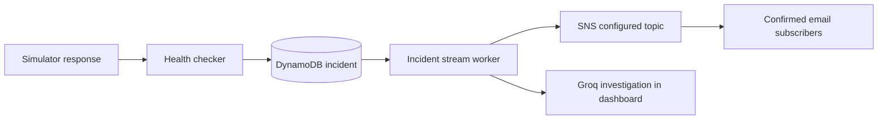
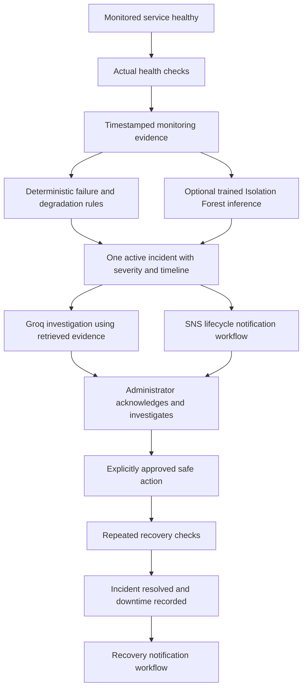
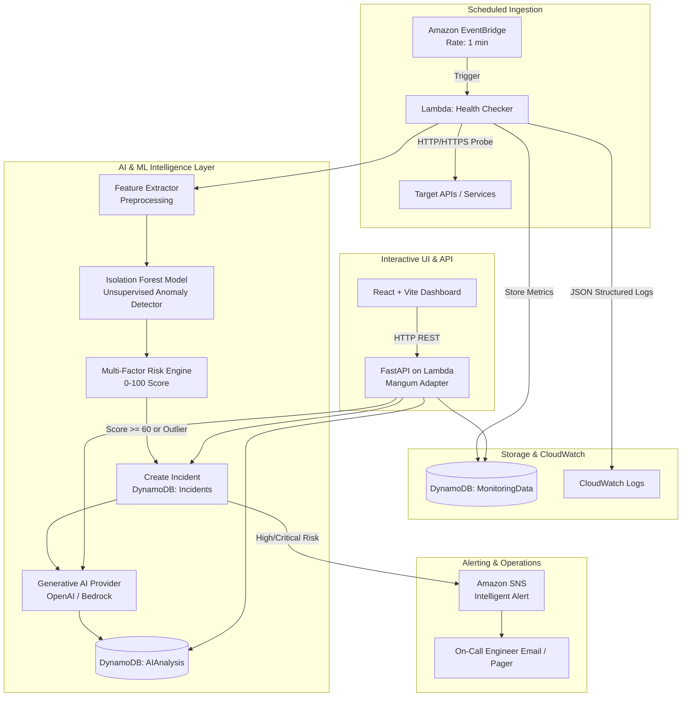

# Complete Project Guide: Intelligent Serverless Monitoring System

## Start here: access the application and monitor your localhost website

There are three separate pieces: **the dashboard** you open in a browser, **the monitoring backend** that sends health requests, and **your simulator** that receives those requests. The backend's location determines which target URL you must register. A dashboard running on your laptop can still control a backend running in AWS.

### 1. Choose the monitoring setup

| Setup | Dashboard talks to | Register this target | Storage and scheduling |
|---|---|---|---|
| Existing cloud deployment, recommended for testing the confirmed SNS subscription | Deployed AWS API | Public HTTPS simulator URL, a public tunnel to your local simulator, or the deployed built-in demo endpoint | DynamoDB and EventBridge |
| Backend running directly on Windows | Local API at `http://127.0.0.1:8001` | For example `http://127.0.0.1:5000/health`, with development private targets enabled | Local SQLite and local monitoring loop |
| Backend running in Docker on this PC | Local API exposed at port 8001 | For example `http://host.docker.internal:5000/health`, with development private targets enabled | SQLite inside the container unless storage is mounted; local monitoring loop |

Port `5000` and path `/health` in this guide are examples. Substitute your simulator's actual port and endpoint. On 9 November 2026, inspection found the `isms-local-upgrade` backend container running with Windows port 8001 exposed, and a separate container exposing port 5000. This does not establish that the port-5000 application is your simulator. The existing frontend build contains the deployed API origin `https://8adg3z8xce.execute-api.ap-south-2.amazonaws.com`.

**AWS Lambda cannot probe your PC through `localhost`.** In Lambda, localhost refers to the Lambda environment. Inside the local backend container, localhost refers to that container. Allowing private targets does not change these network boundaries, and production deliberately continues to reject private targets.

### 2. Open the dashboard for the deployed application

From PowerShell, serve the existing production build:

```powershell
cd C:\Users\Dinu\Documents\serverless_event\frontend
npm.cmd run preview -- --host 127.0.0.1 --port 3001 --strictPort
```

Keep that terminal running and open **http://127.0.0.1:3001**. This is a local dashboard address; the existing build sends API requests to AWS. Opening the AWS API address itself returns backend metadata, rather than the dashboard.

If the `dist` build is missing or you need to rebuild it, run these commands in the frontend directory before starting preview:

```powershell
$env:VITE_API_ORIGIN = 'https://8adg3z8xce.execute-api.ap-south-2.amazonaws.com'
npm.cmd ci
npm.cmd run build
npm.cmd run preview -- --host 127.0.0.1 --port 3001 --strictPort
```

The API origin is embedded at build time. Changing `VITE_API_ORIGIN` when starting preview does not change an already built dashboard. If port 3001 is occupied, open the existing instance or stop the instance you own before restarting; additional origins must match the backend's configured CORS policy.

Production requires the administrator token. Retrieve it privately using your configured AWS CLI identity and copy it to the Windows clipboard:

```powershell
$ismsAdminArn = aws cloudformation describe-stacks --stack-name intelligent-serverless-monitoring --region ap-south-2 --query "Stacks[0].Outputs[?OutputKey=='AdminSecretArn'].OutputValue | [0]" --output text
$ismsAdminValue = aws secretsmanager get-secret-value --secret-id $ismsAdminArn --region ap-south-2 --query SecretString --output text
Set-Clipboard -Value $ismsAdminValue.Trim()
Remove-Variable ismsAdminValue
```

Paste into **Administrator access**, then click **Connect**. This stack's administrator secret is a token value; if using a custom JSON secret, copy its `token` value. Keep the credential out of source files and frontend build variables. The UI stores the supplied token in browser session storage and sends it as a bearer credential. **Sign out** clears the stored token and current data; it does not rotate the shared credential.

### 3. Register your own localhost simulator with AWS monitoring

Give the cloud checker a public HTTPS URL that reaches your local simulator. One development option is Cloudflare Quick Tunnel. Install `cloudflared` using the [official downloads instructions](https://developers.cloudflare.com/cloudflare-one/networks/connectors/cloudflare-tunnel/downloads/), start your simulator, and then run:

```powershell
cloudflared tunnel --url http://localhost:5000
```

Use your real port. The command prints a temporary HTTPS address such as `https://example-random-name.trycloudflare.com`. If your actual probe endpoint is `/health`, register `https://example-random-name.trycloudflare.com/health` in ISMS. Keep both the simulator and tunnel running. This command exposes the service to anyone with the generated URL; use it for the intended simulator. Quick Tunnel hostnames change when recreated and are intended for development. See [Cloudflare Quick Tunnels](https://developers.cloudflare.com/tunnel/get-started/quick-tunnels/).

The probe endpoint must work without a browser login, interactive email challenge, or redirect. ISMS uses GET/HEAD requests, verifies TLS, and does not follow redirects. It also cannot run browser JavaScript. If a simulator page only changes a visual "failed" label while its server still returns HTTP 200 promptly, the checker sees a successful response. Make the actual endpoint return HTTP 500/503 or delay its response to simulate a measurable failure.

In the dashboard, click **Register Service** and use:

| Field | Example | Why it matters |
|---|---|---|
| Service Name | `My Local Failure Simulator` | Identifies the target in incidents, charts, and email |
| Target URL | Your public tunnel URL plus the real health path | This is the exact resource the backend probes |
| HTTP Method | `GET` | Fetches the endpoint without browser interaction |
| Expected Status | `200` | A different HTTP response is a failed observation |
| Check Interval (sec) | `60` | Determines when the service is due for scheduled checks |
| Latency Alert Threshold (ms) | `1000` for an initial tunnel test | Flags successful responses that are too slow; tune after observing normal tunnel latency |
| Dependency service IDs | Leave blank initially | Declare only actual relationships to other registered services |
| Availability target (%) | `99.9` | Sets the sampled reliability objective |
| P95 latency target (ms) | A suitable objective for the service | Supports SLO reporting; distinct from the per-probe latency alert threshold |

Click **Register Target**, then use the service row's **Play** button, whose tooltip is **Run live probe now**. Verify an HTTP 200 observation before introducing failures.

The registration form currently sends a 10-second timeout and uses the schema defaults of three failures and two clean checks. Timeout and failure/recovery thresholds are not editable controls in this form. For a custom timeout, use the service API (see [API.md](API.md)); the accepted timeout range is 1–10 seconds. The interval field accepts 10–3600 seconds, but AWS's one-minute scheduler means a 10-second setting does not produce scheduled checks every ten seconds. Manual probes run on demand.

### 4. Alternative: register localhost with a local monitoring backend

For this setup, use a frontend connected to the local API rather than the production build. In a separate PowerShell terminal:

```powershell
cd C:\Users\Dinu\Documents\serverless_event\frontend
Remove-Item Env:VITE_API_ORIGIN -ErrorAction SilentlyContinue
npm.cmd run dev -- --host 127.0.0.1 --port 3000 --strictPort
```

Open **http://127.0.0.1:3000**. Vite proxies `/api` to `http://127.0.0.1:8001`. Also remove any `VITE_API_ORIGIN` override from frontend environment files if one exists. If port 3000 is already used, choose another free port and configure its exact origin in the local backend CORS settings when making direct cross-origin requests.

For a backend running directly on Windows, set the following in the project-root `.env`, then restart it:

```ini
ENVIRONMENT=development
LOCAL_MONITORING_ENABLED=true
ALLOW_PRIVATE_TARGETS=true
```

```powershell
cd C:\Users\Dinu\Documents\serverless_event
.\.venv\Scripts\python.exe -m uvicorn backend.main:app --reload --port 8001
```

This assumes a Python 3.11 environment with the development requirements installed; see [README.md](README.md). If the Docker backend already owns port 8001, use that backend or stop the instance you own before running another one. Local API documentation is at **http://127.0.0.1:8001/docs** and liveness is at **http://127.0.0.1:8001/health**. A configured local administrator token is still required; without one, explicit development mode uses `local-operator`.

Register `http://127.0.0.1:5000/health` when both the backend and simulator run directly on Windows. For the existing Docker backend, register `http://host.docker.internal:5000/health` instead, assuming Windows exposes the simulator on port 5000. If another container runs the simulator, publish its port to Windows or use an appropriate shared Docker network. The simulator must accept connections from the backend, rather than only browser requests.

For a Docker backend, changing the host `.env` does not change an already running container's environment. Start/recreate the backend with the required settings and preserve any container data you need first. For a new local instance, the repository's documented image can be started with:

```powershell
docker run --rm -p 127.0.0.1:8001:8001 --env-file .env -e ENVIRONMENT=development -e LOCAL_MONITORING_ENABLED=true -e ALLOW_PRIVATE_TARGETS=true -e DEMO_ENABLED=true isms-test python -m uvicorn backend.main:app --host 0.0.0.0 --port 8001
```

Run from the project root, ensure the `isms-test` image exists, and ensure port 8001 is free. This example is ephemeral: without a volume, SQLite/model files created in the container disappear when it is removed. It does not replace or stop an existing container automatically.

Local services and incidents are separate from AWS DynamoDB records. Local incidents can publish to SNS only if `SNS_TOPIC_ARN` names the subscribed topic, `SNS_ALERT_ENABLED=true`, and the backend process has usable AWS credentials with `sns:Publish` permission for that topic. Windows AWS CLI credentials are not automatically available inside Docker. Confirming a cloud SNS subscription alone does not configure the local backend to publish.

## Guided dashboard tour: what each feature does and why it exists

Follow this order after connecting to the intended backend. Dashboard data refreshes approximately every 15 seconds while the page is open. The refresh button fetches existing data; the Play button performs a new health check. Closing the browser does not stop EventBridge monitoring; local monitoring continues only while the local backend is running.

### 1. Administrator access and connection errors

**Use:** Enter the administrator token and select **Connect**. Use **Sign out** to clear it from the current browser session.

**Purpose:** Protect service configuration, incident actions, and operational evidence. The red data-unavailable banner identifies an access/network/backend problem. Previously loaded data may remain visible and stale; an error does not establish that all monitored services are healthy or absent.

### 2. Overview cards

| Card | What it shows | Why it exists |
|---|---|---|
| System Health Index | Aggregate current health score, or Unknown without evidence | Helps prioritize overall attention; it is not a future-outage probability |
| Services Status | Registered service count and healthy/degraded/down counts | Shows how widely problems are spread |
| Active Incidents | Unresolved incident count | Identifies ongoing response work |
| Avg Response Time | Aggregate latest observed response time | Gives a current latency overview |
| Overall Availability | Availability from latest probes, with unknown services identified | Gives a current snapshot; use service reliability for a historical window |

### 3. Monitored Services and registration

**Use:** Open **Monitored Services**, click **Register Service**, fill in the target settings, and select **Register Target**. Each row shows the latest status, latency, HTTP code, and interval. Pending means no usable observation is available yet.

**Purpose:** Define what to monitor and the expected behavior of each endpoint. Registration creates configuration; a probe creates telemetry. Changing your simulator's mode alone does not create an ISMS observation until a check runs.

### 4. Service-row action buttons

| Button | Action | Purpose |
|---|---|---|
| Play: Run live probe now | Sends a real health check through the same pipeline used by scheduling | Verify a target immediately or speed up a controlled demonstration |
| Eye: View telemetry & charts | Opens service history, reliability, model information, and recent telemetry | Understand trends and inspect the evidence behind current status |
| Trash: Delete service | Removes the registered service after confirmation | Stop future checks for a target; this does not automatically erase historical records or resolve an existing incident |

Wait for each manual check to finish before starting another for the same service. Background monitoring can also add observations during a demonstration, so exact row counts can differ from the number of clicks.

### 5. Service details, charts, and reliability

**Use:** Click the Eye button. Inspect the last-24-hour observations, latency threshold, HTTP outcomes, and ML assessment. The recent log shows up to 15 records from the loaded history.

**Purpose:** Separate a single bad observation from a sustained trend. P50/P95/P99 summarize observed latency distributions; availability/error rate summarize the sampled checks. Error budget and SLO status compare the observations with configured objectives. MTTR describes observed repair duration and MTBF describes observed intervals between failures when sufficient records exist. These are sampled-probe measures, not full customer-request analytics. "Insufficient data" is an explicit limit rather than a zero measurement.

### 6. Retrain ML and model metadata

**Use:** After collecting at least 20 valid real observations, click **Retrain ML** in service details. Inspect model version, sample count, threshold, and training timestamp.

**Purpose:** Learn a service-specific baseline for unusual observations. Training validates the candidate before promotion; insufficient data or rejected evaluation leaves the active model unchanged. A missing model does not prevent HTTP failure detection. An ML anomaly is a relative deviation, not proof of an outage or a prediction that one will occur. See [ML.md](ML.md) for the exact ten features and evaluation limits.

### 7. Incidents & AI Triage

**Use:** Open the **Incidents & AI Triage** tab after sustained failure/degradation. Inspect severity, status, detection source, and **AI Insights**. Use acknowledgement to record that someone has taken responsibility.

**Purpose:** Keep the failure episode and its evidence together. Three consecutive failures confirm an incident under the default settings; repeated failures update it. The latest service status and the incident's response state answer different questions: the endpoint can remain down after an operator acknowledges it.

### 8. Incident response and predefined actions

**Use:** In **Incident response**, move through acknowledged, investigating, and mitigating as appropriate. Use **Authorize retry check**, **Mute 1 hour**, or **Unmute** when required.

**Purpose:** Record operational ownership and approved actions. The backend enforces allowed transitions, so jumping backward or to an invalid state can fail. Retry runs another probe; mitigation status does not repair your simulator; mute suppresses eligible ongoing alerts temporarily. Recovery notifications remain eligible even while muted. Recovery is verified by monitoring, and manual resolution of an unverified outage is rejected.

### 9. AI Insights and AI Assistant

**Use:** Open an incident's **AI Insights** to inspect persisted investigation or request analysis. Use **AI Assistant** for questions such as "Which services are unhealthy?", "Which services had the most failed probes in the last 24 hours?", or "What evidence supports this incident?" Opening the assistant from an incident supplies that context.

**Purpose:** Reduce manual evidence assembly and suggest useful investigation steps. Groq works with retrieved facts; backend measurements supply numerical answers. Possible causes remain unconfirmed. Missing application logs and deployment events are identified because this system does not ingest them. Missing credentials, a provider outage, or invalid output appears as an unavailable/error state. AI does not execute remediation commands.

### 10. Dependencies & blast radius

**Use:** Register a service with dependency IDs for services already present in the same backend. Read the arrows as "source depends on dependency."

**Purpose:** Show potentially affected downstream services and guide investigation of shared failures. The backend rejects dependency cycles. Declaring a dependency does not configure traffic routing or prove that a dependency caused an outage.

### 11. Failure demonstration controls

**Use:** Select ONLINE, HTTP_500, HTTP_503, TIMEOUT, SLOW_RESPONSE, or RECOVERY and click **Apply demo mode**.

**Purpose:** Change the application's own built-in demo endpoint to demonstrate actual response failures/delays. **These controls do not change your separately created localhost simulator.** Use your simulator's own controls for that target. Built-in controls return 404 if the demo is disabled. Register the built-in target before expecting checks against it: use the stack's `DemoHealthEndpoint` in AWS, or local `/demo/health` when enabled. Retrieve the cloud URL with:

```powershell
aws cloudformation describe-stacks --stack-name intelligent-serverless-monitoring --region ap-south-2 --query "Stacks[0].Outputs[?OutputKey=='DemoHealthEndpoint'].OutputValue | [0]" --output text
```

### 12. System timeline and Recovery

**Use:** Inspect **System timeline** for recent incident, operator, AI, and notification events. Inspect **Recovery** for resolved incidents and measured downtime.

**Purpose:** Reconstruct what happened and distinguish first success from verified recovery. The dashboard timeline shows the 12 newest events from loaded incidents; it is a bounded view. Downtime is bounded by probe timing, so it does not establish the exact instant the application failed between probes.

### 13. Notifications and email delivery

**Use:** In Incident response, check that **Notifications** reports at least one confirmed email subscription. This reflects the SNS topic configured on the backend you are currently using.

**Purpose:** Explain whether lifecycle alerts have a delivery destination. The user has reported confirming the SNS email subscription; this is a user-reported update to the earlier acceptance record, rather than a new API/inbox verification. Confirm the topic matches the application configuration and perform the failure/recovery test below to verify receipt.

Cloud delivery follows this path:



The worker publishes before AI investigation, so notifications do not depend on successful Groq analysis. Subjects resemble `ISMS CREATED: HIGH My Local Failure Simulator` and `ISMS RECOVERY: HIGH My Local Failure Simulator`. The current JSON body contains event, incident ID, service, severity, status, metrics evidence, downtime when available, and an unconfirmed-cause notice. It does not include the full AI investigation.

All confirmed email subscribers to that topic receive its published alerts. Registering a service does not automatically subscribe that service's website users or provide per-user/per-service email routing. Repeated failures normally update one incident without resending its creation notification. Critical-severity and sustained-outage escalation have separate notification types; the default escalation duration is 900 seconds and publishing is evaluated when incident processing runs. SNS acceptance recorded as `sent` is distinct from confirmed inbox receipt.

## First complete walkthrough: healthy -> failed -> email -> recovered

1. Start your simulator and verify its actual probe endpoint returns HTTP 200. For cloud monitoring, keep its public tunnel running and register the tunnel URL. For local monitoring, use the correct Windows/container URL and enable development private targets.
2. Connect the dashboard to the intended backend. Register the service with expected status 200, a 60-second interval, and a latency threshold that normal responses satisfy. Check the configured SNS subscription count if testing email.
3. Press Play once and inspect the latest HTTP code/latency. Open Eye to inspect the stored observation. Establish the healthy baseline before testing failure; ML training is optional for this demonstration.
4. Change your simulator so the actual endpoint returns HTTP 503. Press Play three times sequentially, or wait for scheduled observations. With the default failure threshold, sustained failure creates one incident. Dashboard polling can take about 15 seconds to show background updates.
5. Open Incidents & AI Triage and inspect the incident. Acknowledge it, review AI Insights when available, and inspect timeline notification events. Allow for stream processing and email delivery time, then check the confirmed inbox and Spam/Junk folder.
6. Restore the simulator to HTTP 200 with acceptable latency. Run two sequential clean probes under the default recovery threshold. The first enters recovery pending; the second resolves the incident. Additional ML/latency degradation can delay a clean recovery.
7. Check Recovery, the resolved timeline, and the recovery email. Keep both emails as evidence of actual delivery; subscription confirmation alone does not prove lifecycle messages were delivered.
8. Separately demonstrate optional ML by collecting sufficient real history, training a model, and inspecting subsequent model-assessed observations. Avoid presenting an ordinary HTTP 503 rule detection as an ML prediction.

## Access and localhost troubleshooting

| Symptom | What to check |
|---|---|
| Browser cannot open port 3001 | Start the frontend preview and keep its terminal running; verify the actual printed URL |
| API URL shows JSON instead of a dashboard | Open the frontend URL; the API is a separate application surface |
| Unauthorized / 401 | Enter the correct backend's administrator token and click Connect |
| Services differ between ports 3000 and 3001 | Check the embedded API origin; local SQLite and cloud DynamoDB contain separate records |
| Private targets are disabled | Cloud monitoring needs a public HTTPS target; local monitoring needs development mode plus `ALLOW_PRIVATE_TARGETS=true` and a restart |
| Localhost target fails from Docker | Use `host.docker.internal` and the host-published simulator port; check reachability from the backend |
| Simulator says failed but ISMS records 200 | Make the probed server endpoint fail; browser-only state is invisible to a GET/HEAD probe |
| Redirect or login page is observed | Register the direct endpoint; the probe does not follow redirects or perform interactive authentication |
| No email after one failed check | Check the configured failure threshold, confirmed incident, matching topic, notification configuration/history, and mute state |
| Cloud email works but local email does not | Configure the local SNS topic and supply the local process/container with authorized AWS credentials |
| Mode change has no effect on your custom simulator | Built-in Apply demo mode controls only the built-in endpoint; change your custom simulator separately |
| Slow mode does not trigger an incident | Compare actual delay with the latency alert threshold; sustained degradation needs repeated evidence |
| Retrain ML reports insufficient data | Collect at least 20 valid real observations; the system does not generate training measurements |

## Current upgrade: what changed

ISMS now combines service monitoring, stateful incident response, optional machine learning, evidence-based Groq investigation and administrator actions in the existing React/Vite and AWS SAM application. The upgrade preserves the original FastAPI/Lambda architecture and four DynamoDB tables. It adds the execution paths, persistence, safeguards and verification needed to connect those features.

The following describes the implemented upgrade. The original guide is retained separately below as historical reference. For the original findings, see [AUDIT.md](AUDIT.md); for the complete file-level change record, see [CHANGES.md](CHANGES.md).

| Area | Before the upgrade | What changed | Main implementation files |
|---|---|---|---|
| Monitoring engine | Basic HTTP probes; scheduled checks ignored individual service intervals | One shared manual/scheduled pipeline; due-service filtering; distinct HTTP, DNS, connection, TLS and timeout outcomes; validated, pinned target addresses; timestamped observations with TTL | `backend/lambdas/health_checker/handler.py`, `backend/utils/targets.py`, monitoring repository |
| Incident detection | Deduplication depended on a limited incident lookup; an existing outage could enter the resolution path incorrectly | Consecutive failure/success tracking, sustained latency/error detection, measured severity, a consistent active-incident pointer, per-service leases and conditional writes | `backend/lifecycle.py`, `backend/database/concurrency.py`, incident/service repositories |
| Recovery | One successful check could resolve an incident | Recovery pending followed by multiple clean checks; a failed recovery returns to the existing incident; observed downtime and timeline are recorded | `backend/lifecycle.py` |
| Administrator workflow | Incident PATCH passed an unsupported repository argument | Working acknowledgement, investigation and mitigation transitions; actor, timestamp and comments are recorded; operators cannot bypass recovery verification | Incident API routes, `backend/lifecycle.py` |
| ML training | Retraining could insert random baseline samples into real monitoring storage | Training uses actual historical observations; minimum-data and finite-value validation; chronological holdout diagnostics; rejected candidates preserve the active model | `backend/ml/preprocessing.py`, `backend/ml/train.py`, AI retraining route |
| Model persistence | Local model files in Lambda temporary storage were not durable or shared | Immutable S3 artifacts, model version, timestamp, feature schema, checksum, threshold and evaluation metadata; active pointer published after successful preparation; cold-start loading | `backend/ml/model_manager.py`, `backend/ml/predict.py` |
| Training execution | Standalone detector Lambda had no configured trigger | The retained function is now a daily historical training worker; manual retraining also performs actual training and records attempts | `backend/lambdas/anomaly_detector/handler.py`, `template.yaml` |
| AI incident investigation | Real provider integration existed, but context was limited and the deployed analyzer was untriggered | Incident-stream processing gathers snapshots, recent observations, detector provenance, related incidents, dependencies and timelines before Groq inference; unavailable evidence is identified | `backend/ai/incident_analysis.py`, analyzer handler, `backend/operations.py` |
| AI assistant | Latest-sample context could not substantiate many historical questions | Read-only application tools retrieve real data; backend facts supply counts, rankings and measurements; Groq selects valid fact IDs and proposes unconfirmed hypotheses; today/this-week queries use explicit UTC calendar boundaries | `backend/ai/tools.py`, `backend/ai/grounding.py`, AI API routes |
| Notifications | SNS topic existed without a template-managed email subscription; notification behavior was limited | Incident-created, critical escalation, sustained-outage escalation and recovery workflows; publish history, duplicate suppression, muting and retry handling; optional email subscription in SAM | `backend/notifications.py`, analyzer handler, `template.yaml` |
| Reliability and SLOs | Latest samples were presented as broad health/availability summaries | Probe-based availability/error rate, latency percentiles, error budget, SLO status and observed MTTR/MTBF; insufficient observations remain unknown | `backend/operations.py`, metrics/operations API routes |
| Dependencies and correlation | No connected dependency investigation workflow | Declared service relationships, cycle validation, unhealthy dependencies, transitive affected-service counts and a combined incident/monitoring timeline | `backend/operations.py`, service/operations API routes |
| Controlled remediation | No audited execution path for safe administrator actions | Explicitly authorized retry-health-check, one-hour alert mute and unmute actions; each records actor, action, time and result | `backend/api/routes/operations.py` |
| Dashboard | Fetch errors could appear as empty data; HTTP errors could be labeled ML anomalies | Connected incident actions, dependency views, recovery/timeline panels, real model/reliability details, administrator access, configurable API origin and visible data-fetch errors | `frontend/src/App.jsx`, `OperationsPanel.jsx`, existing detail/incident components and API client |
| Local storage | File-backed adapter had inconsistent keys, filters and updates and swallowed failures | Explicit SQLite development storage with atomic conditional writes; production database failures surface as platform failures; original JSON data is retained with a migration script | `backend/database/local.py`, `backend/database/dynamodb.py`, `scripts/migrate_local_data.py` |
| Security and platform observability | Public administrator routes, wildcard CORS and unused authentication settings | Production bearer authentication, managed secret references, scoped CORS/IAM, URL and request validation, secret sanitization, platform failure logs/alarms and failed-event retention | `backend/utils/security.py`, `backend/main.py`, schemas/logger, `template.yaml` |
| Failure demonstration | Seeded fictional services, telemetry and AI explanations | Actual ONLINE, HTTP 500, HTTP 503, TIMEOUT, SLOW RESPONSE and RECOVERY behavior; a script exercises the real incident/Groq/recovery workflow | `backend/demo.py`, `scripts/demo.py`, `scripts/seed_data.py` |
| Build, tests and documentation | Broken paths and deployment assumptions were insufficiently verified | Automated regression/integration tests, patched dependencies, CI configuration, Linux SAM builds, artifact/source/size checks and import/inference verification of the pruned Lambda package | `tests/`, `.github/workflows/verify.yml`, `backend/build_package.py`, `scripts/verify_build.py`, current documentation |

### The operational workflow now



ML contributes evidence when a compatible trained model exists. Deterministic failure detection continues when ML or Groq is unavailable. A failed probe, an ML anomaly and an AI hypothesis have separate meanings and provenance.

## What distinguishes ISMS now

The project's distinguishing design is the combination of observable monitoring, explainable investigation and controlled incident response in one small serverless codebase.

### 1. Evidence-based AI with verifiable measurements

The assistant retrieves application data before answering operational questions. Numerical facts are rendered from backend results, and generated responses must reference known fact IDs. This supports questions about unhealthy services, measured failure rankings, incident counts and latency trends while retaining the source context.

For example, a live demonstration returned **four failed probes out of five retrieved probes**. The system also reported that ML made no assessment because no model was loaded. Possible explanations remained explicitly unconfirmed.

### 2. Clear separation of rules, ML and AI

| Layer | Responsibility | Example |
|---|---|---|
| Deterministic monitoring | Establish directly measured endpoint behavior | An expected HTTP 200 check returned HTTP 503 |
| Isolation Forest | Identify unusual observations relative to a trained baseline | Response-time/features deviate from learned behavior |
| Groq investigation | Interpret supplied evidence and suggest diagnostic checks | Propose an upstream dependency issue as an unconfirmed hypothesis |

This separation makes the system easier to explain, test and defend during a project presentation. An anomaly score is a relative model score, and a risk score is a heuristic; neither is a calibrated probability of a future outage.

### 3. A complete incident lifecycle with recovery verification

ISMS tracks an incident from suspected failure through confirmation, administrator investigation, recovery pending and resolution. Repeated failures update the same incident. Recovery requires clean checks, and a relapse retains the incident rather than generating a new incident every minute. The timeline preserves the response history.

### 4. Dependency-aware investigation

Declared service relationships allow the application to show potentially affected downstream services and a blast radius. Monitoring events and nearby incidents provide a timeline for investigation. These correlations help prioritize checks while keeping causal conclusions unconfirmed when supporting evidence is missing.

### 5. Retraining that can be inspected and reproduced

Retraining reads real monitoring history, validates it, evaluates a candidate and publishes a versioned artifact. Metadata exposes when training occurred, how much data was used, which features and threshold apply, and what the holdout diagnostics showed. Failed or invalid training does not replace the active model. S3 persistence supports sharing a model across Lambda execution environments.

### 6. Controlled, accountable remediation

An administrator can authorize a predefined retry or alert-management action. The system records who initiated it and what happened. AI recommendations cannot execute arbitrary commands or select arbitrary functions. Recovery is established by subsequent monitoring evidence.

### 7. Reliability engineering alongside service status

Availability, error rate, latency percentiles, error budget and SLO status provide measurable reliability context. MTTR and MTBF use observed incident intervals. Missing observations and insufficient sample sizes remain explicit, making the dashboard useful for discussing both current failures and reliability over time.

### 8. A real, repeatable demonstration

The demo changes the actual endpoint's response or delay. It can demonstrate a healthy service, degradation, outage, investigation, acknowledgement and verified recovery. The same monitoring pipeline serves manual checks and scheduled checks, which helps connect presentation behavior to the implementation.

### 9. Serverless operation with platform failure visibility

The application retains AWS-native services and SAM deployment in **ap-south-2**. TTL, bounded data/context retrieval, investigation-on-incident behavior, log retention and shared dependencies control resource usage. Platform failures have their own logs, alarms and failed-event handling so they can be investigated separately from a monitored service outage.

### Suggested project presentation description

> ISMS is a serverless monitoring and incident-response platform that combines deterministic health checks, optional Isolation Forest anomaly detection and evidence-based Groq investigation. It manages deduplicated incidents through verified recovery, exposes dependency and reliability context, and supports audited administrator actions. Its assistant reports measured application facts separately from possible causes and recommended investigation.

## Verification status and practical limits

As recorded in [TESTING.md](TESTING.md), **54 automated tests passed** on the Linux Python 3.11 runtime. The frontend production build, source/built SAM validation and SAM container build passed. All five Lambda artifacts matched the deployable source; each combined code/layer package measured **234.46 MiB**, and the actual pruned artifacts constructed the retained AWS SDK clients, imported, and performed ML inference in the AWS Python 3.11 build runtime. Dependency audits reported no known vulnerabilities at the time of verification.

The local end-to-end demonstration used actual HTTP checks and actual Groq investigation/assistant calls. All six simulator modes were exercised. Automated SNS tests use explicit mocks or AWS emulation; local SNS was unconfigured.

**The existing AWS stack is deployed and the core cloud workflow passed acceptance.** Verified: administrator authentication/CORS, EventBridge monitoring, incident-stream execution, actual Groq investigation/assistant, SNS creation/recovery publishing, real model training, and S3 model loading/inference in a fresh health-checker Lambda environment. At that acceptance run, SNS email confirmation/inbox delivery, public frontend hosting, visual browser acceptance, deliberate failed-event delivery, and the next daily training schedule occurrence remained pending. The user has since reported confirming the email subscription; actual lifecycle-email inbox receipt still requires the walkthrough above. The CI workflow was added but has not run on GitHub in this session. Detailed historical evidence is in TESTING.md.

Reliability percentages are based on retrieved probe samples. Application-log ingestion, deployment-event ingestion, individual SSO/RBAC and supervised future-outage forecasting are outside the implemented feature set. See [AI.md](AI.md), [ML.md](ML.md) and [OPERATIONS.md](OPERATIONS.md) for the evidence and statistical limits.

Current setup and deployment instructions: [README.md](README.md), [DEPLOYMENT.md](DEPLOYMENT.md), [API.md](API.md) and [ARCHITECTURE.md](ARCHITECTURE.md).

---

<details>
<summary>Historical project guide — original implementation and examples</summary>

The material below is retained for historical reference. Its original feature, deployment, model and fallback claims are superseded by the current sections and linked documentation above. Historical examples are not evidence of deployed behavior.

---

## 1. Executive Summary & Problem Statement

### 1.1 The Traditional Monitoring Problem
Traditional serverless and cloud monitoring solutions (such as basic CloudWatch Alarms, UptimeRobot, or Pingdom) rely on **static threshold rules** (e.g., alert if HTTP status is 500 or latency > 2000ms).

This legacy paradigm suffers from three critical limitations:
1. **Alert Fatigue & Noise**: Temporary network fluctuations trigger false positives, waking on-call engineers for non-actionable spikes.
2. **Delayed Detection of Subtle Degradation**: Micro-outages, gradual memory leaks, connection pool exhaustion, and intermittent jitter often hover just below static thresholds until a catastrophic cascading failure occurs.
3. **Lack of Explainability & Context**: Traditional alerts deliver raw error codes (`HTTP 504 Gateway Timeout`) with zero context. Engineers must manually search through thousands of raw CloudWatch log streams to deduce what went wrong.

---

### 1.2 The Intelligent Monitoring Solution
The **Intelligent Serverless Monitoring System** preserves the lightweight efficiency of the AWS serverless paradigm (**EventBridge → Lambda → DynamoDB → CloudWatch → SNS**) while augmenting it with an **Intelligent AI Layer**:

* **Unsupervised Anomaly Detection (Isolation Forest)**: Learns multi-dimensional distributions of response times, jitter, status codes, and error ratios without needing labeled failure data.
* **Multi-Factor Risk Scoring Engine (0–100)**: Combines statistical deviation, threshold breach ratios, and ML anomaly scores into a single actionable risk index.
* **Generative AI Root-Cause Explainability**: Evaluates raw telemetry and log evidence to output an Executive Incident Summary, Observed Telemetry Facts, Probable Architectural Root Causes, and Actionable Remediation Steps.
* **Interactive SRE Assistant**: Allows engineers to converse with an AI agent with full context over active telemetry and historical incidents.

---

## 2. System Architecture & End-to-End Workflow



### 2.1 Detailed Execution Steps

1. **Trigger**: Amazon EventBridge schedules the `HealthChecker` Lambda once per minute.
2. **Probing**: For every active service in the `Services` DynamoDB table, an asynchronous HTTP probe is dispatched, measuring exact response time, status code, and payload availability.
3. **Storage**: Telemetry records are saved to the `MonitoringData` DynamoDB table (with TTL for automatic data lifecycle management).
4. **ML Anomaly Scoring**: The `IsolationForest` model evaluates the record against historical baseline features:
   - Base metrics: latency, error rate, availability, normalized status code.
   - Derived metrics: rolling average response time, rolling error rate, change ratio vs. 20-sample historical window.
5. **Composite Risk Calculation**: The Multi-Factor Risk Engine calculates:
   $$\text{Risk Score} = 0.25(\text{Threshold Breach}) + 0.15(\text{StdDev Deviation}) + 0.25(\text{Error Rate}) + 0.20(\text{Outage Penalty}) + 0.15(\text{Anomaly Score})$$
6. **Incident Creation & AI Analysis**:
   - If risk is `HIGH` or `CRITICAL`, an incident is recorded in DynamoDB.
   - The Generative AI layer evaluates the telemetry evidence and generates a structured root-cause diagnosis.
7. **Intelligent Alert**: Amazon SNS dispatches an alert email containing both telemetry metrics and the AI's step-by-step remediation guide.
8. **Dashboard Visualization**: Operators inspect real-time latency graphs, trigger on-demand probes, chat with the AI SRE Assistant, and resolve incidents.

---

## 3. How to Use the Project (Local Development)

### 3.1 Prerequisites
- **Python 3.10+**
- **Node.js 18+ & npm**
- *(Optional)* AWS CLI & AWS SAM CLI for cloud deployment

---

### 3.2 Step 1: Clone and Configure Environment

```bash
git clone <your-repo-url>
cd serverless_event

# Create your local environment file
cp .env.example .env
```

Configuration in `.env`:
```ini
# AWS Region & Environment
AWS_REGION=us-east-1
ENVIRONMENT=development

# AI Provider (Groq; get a key from https://console.groq.com/keys)
AI_PROVIDER=groq
GROQ_API_KEY=your-groq-api-key
GROQ_MODEL=openai/gpt-oss-120b
```

The assistant calls Groq directly through its OpenAI-compatible API using `openai/gpt-oss-120b`, and grounds answers in the service, telemetry, and incident context supplied by the application. It declines unrelated questions and reports missing provider configuration instead of substituting a canned response. In PowerShell, clear stale `GROQ_API_KEY` and `GROQ_MODEL` process environment variables before restarting the backend if you want it to load the values from `.env`. Keep `.env` private and never commit a real API key.

In local development, the backend checks active services automatically according to each service's `check_interval`. Set `LOCAL_MONITORING_ENABLED=false` in `.env` to disable it. On AWS, EventBridge continues to invoke the scheduled health-check Lambda.

---

### 3.3 Step 2: Start the FastAPI Backend

```bash
# In project root:
python -m pip install -r backend/requirements-dev.txt

# Launch FastAPI on port 8001
python -m uvicorn backend.main:app --reload --port 8001
```
- **Interactive Swagger Docs**: [http://127.0.0.1:8001/docs](http://127.0.0.1:8001/docs)
- **API Health Check**: [http://127.0.0.1:8001/health](http://127.0.0.1:8001/health)

---

### 3.4 Step 3: Seed Sample Telemetry & Incidents

In a second terminal window, populate demo services, historical 24h metrics, and an active incident:

```bash
python scripts/seed_data.py
```

---

### 3.5 Step 4: Start the React Dashboard

```bash
cd frontend
npm install
npm run dev
```

Open **[http://localhost:3000](http://localhost:3000)** in your browser.

---

### 3.6 Dashboard Features & Walkthrough

| Feature | Description | Action |
| :--- | :--- | :--- |
| **System Health Index** | Real-time 0–100 composite operational health gauge. | Visual gauge at top of page. |
| **Monitored Services** | Grid of all monitored endpoints with latency & status. | Click **Play** for live probe; click **Eye** for detailed 24h charts. |
| **Isolation Forest Retraining** | Retrain unsupervised ML model per service on demand. | Click **Retrain ML** in the service modal. |
| **AI Incident Triage** | View active outages and predictive degradation alerts. | Click **AI Insights** on any open incident. |
| **SRE AI Assistant** | Ask natural language questions about telemetry & risks. | Click **AI Assistant** in top navigation bar. |
| **Register Target** | Add new API/website endpoints with custom thresholds. | Click **Register Service** in top navigation bar. |

---

## 4. AWS Cloud Deployment Guide (AWS SAM)

### 4.1 Architecture on AWS
Deploying [`template.yaml`](file:///c:/Users/Dinu/Documents/serverless_event/template.yaml) creates the following AWS serverless resources:

1. **4 DynamoDB Tables**: `Services`, `MonitoringData` (with TTL), `Incidents` (with GSI), `AIAnalysis` (with GSIs).
2. **3 Event-Driven Lambda Functions**:
   - `HealthCheckerFunction`: Runs on 1-minute EventBridge schedule.
   - `AnomalyDetectorFunction`: Standalone stream processor.
   - `IncidentAnalyzerFunction`: Asynchronous LLM incident explainer.
3. **1 API Gateway + FastAPI Lambda**: `ApiFunction` routing all REST traffic through HTTP API Gateway.
4. **1 Amazon SNS Topic**: `serverless-monitoring-alerts` with email subscription.

---

### 4.2 Deployment Steps

#### 1. Configure AWS CLI Credentials
```bash
aws configure
# Enter AWS Access Key ID, Secret Access Key, and Default region (e.g., us-east-1)
```

#### 2. Build the Serverless Application
```bash
sam build --use-container
```

#### 3. Deploy with Guided Setup
```bash
sam deploy --guided
```

When prompted for `GroqApiKey`, provide a valid key. It is marked `NoEcho` by CloudFormation; do not save it in a committed `samconfig.toml`.

SAM will prompt you for:
- **Stack Name**: `serverless-event-monitor`
- **AWS Region**: `us-east-1` (or your preferred region)
- **Confirm changes before deploy**: `Y`
- **Allow SAM CLI IAM role creation**: `Y`
- **Disable authorization for HttpApi**: `Y` (or attach Cognito/API Key)

#### 4. Post-Deployment Outputs
Once deployed, SAM outputs:
```
Outputs:
-------------------------------------------------------------------------------------------------
Key                 ApiEndpoint
Description         HTTP API Gateway endpoint URL for FastAPI backend
Value               https://abc123xyz.execute-api.us-east-1.amazonaws.com

Key                 SnsTopicArn
Description         Amazon SNS Topic ARN for intelligent alerting
Value               arn:aws:sns:us-east-1:123456789012:serverless-monitoring-alerts
-------------------------------------------------------------------------------------------------
```

#### 5. Subscribe Your Email to SNS Alerts
```bash
aws sns subscribe \
    --topic-arn <YOUR_SNS_TOPIC_ARN> \
    --protocol email \
    --notification-endpoint your-email@example.com
```
*Check your inbox and click "Confirm subscription".*

#### 6. Deploy the Frontend (S3 + CloudFront or Vercel)
```bash
cd frontend
# Point API base URL to your deployed API Gateway endpoint in vite.config.js
npm run build

# Sync build files to an S3 static hosting bucket
aws s3 sync dist/ s3://your-monitoring-dashboard-bucket/ --delete
```

---

## 5. Security & Cost Optimization Highlights

1. **Least-Privilege IAM Policies**: Each Lambda function is granted access only to the DynamoDB tables and SNS topics it needs.
2. **Log Sanitization**: The [`sanitize_log_content`](file:///c:/Users/Dinu/Documents/serverless_event/backend/utils/validators.py) utility automatically redacts API keys, JWTs, and AWS credentials before forwarding evidence to LLM providers.
3. **LLM Cost Control**: The Generative AI layer is called **only** when risk escalates to `HIGH` or `CRITICAL`, preventing unnecessary token consumption during normal healthy checks.
4. **Graceful Degradation**: If an external LLM API rate limit or outage occurs, the system automatically falls back to rule-based explainability, ensuring zero monitoring downtime.

</details>
