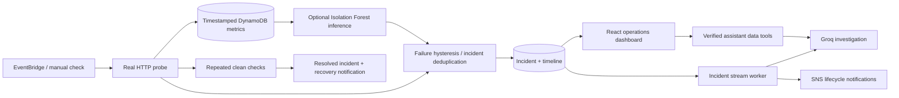

# Intelligent Serverless Monitoring System (ISMS)

ISMS monitors real HTTP(S) endpoints with React/Vite, FastAPI on AWS Lambda, DynamoDB, EventBridge and SNS. Isolation Forest supplies optional anomaly evidence; Groq investigates incidents and selects verified facts for an operational assistant.

The existing repository was audited before changes. See [AUDIT.md](AUDIT.md) for the original execution paths, broken/mocked/missing features and target design, and [CHANGES.md](CHANGES.md) for grouped implementation evidence. No production rewrite or arbitrary command execution was introduced.

## Implemented workflow



Monitoring distinguishes HTTP status mismatch, timeout, DNS, connection and TLS errors. TLS verification stays enabled. Stateful checks prevent duplicate incidents and require verified recovery. Operators can acknowledge, investigate, mitigate, retry a probe and temporarily mute incident notifications. Dependencies, correlation timelines, measured reliability/SLOs, actual model retraining, a failure simulation service and platform alarms are connected to backend execution.

ML anomalies are unusual observations, not predictions of future outages. HTTP 503 is deterministic failure detection. Insufficient data and missing models remain explicit. The assistant renders counts/measurements from backend facts and uses Groq for fact selection and unconfirmed investigation. Missing application logs/deployment telemetry are identified instead of invented.

## Local start

Use Python 3.11 for parity with Lambda and Node.js 20.19+ or 22.12+ for Vite. Copy `.env.example` to `.env`, set `GROQ_API_KEY`, and keep `AI_PROVIDER=groq`. The model is configurable through `GROQ_MODEL`. Restart after configuration changes. Process environment variables override `.env`; clear stale PowerShell `GROQ_API_KEY` / `GROQ_MODEL` overrides if needed.

```powershell
python -m venv .venv
.\.venv\Scripts\python.exe -m pip install -r backend/requirements-dev.txt
.\.venv\Scripts\python.exe -m uvicorn backend.main:app --reload --port 8001
```

Local development automatically checks active services according to their configured intervals. Set `LOCAL_MONITORING_ENABLED=false` to disable it. Local storage is explicitly SQLite (`.local_db.sqlite3`), separate from AWS; production database failures never silently switch to local storage. The original `.local_db.json` is retained; migrate it explicitly with `python scripts/migrate_local_data.py` if you need existing local records.

```powershell
cd frontend
npm ci
npm run dev
```

Dashboard: http://localhost:3000. API docs: http://127.0.0.1:8001/docs. A configured `ADMIN_TOKEN` is required locally; otherwise local mode identifies actions as `local-operator`. Production always requires its managed administrator credential. Enter it into the dashboard access field; never embed it in a frontend build.

On machines where Windows application control blocks native Python dependencies, run the same Python 3.11 runtime in Docker:

```powershell
docker build -f Dockerfile.test -t isms-test .
docker run --rm -p 127.0.0.1:8001:8001 --env-file .env -e ENVIRONMENT=development -e DEMO_ENABLED=true -e ALLOW_PRIVATE_TARGETS=true isms-test python -m uvicorn backend.main:app --host 0.0.0.0 --port 8001
```

Enable `DEMO_ENABLED=true` and development-only `ALLOW_PRIVATE_TARGETS=true` for a local demo. Run `python scripts/demo.py --require-ai` against the running backend. This generates real HTTP failures and recovery; it does not seed invented AI or telemetry. The old seed command now only registers an actual demo endpoint.

## Deployment and verification

AWS region is **ap-south-2**. Start with [DEPLOYMENT.md](DEPLOYMENT.md). SAM manages the original four DynamoDB tables and Lambda/API architecture, plus a shared dependency layer, versioned model bucket, incident stream, failure queue, secrets and optional demo/email subscription. Existing fixed table names are retained for compatibility; use the existing stack when updating an installation.

```powershell
sam validate --lint --region ap-south-2
sam build --use-container --region ap-south-2
sam deploy --guided --region ap-south-2
```

The existing stack is deployed in ap-south-2. Actual scheduled monitoring, incident streams, Groq investigation/assistant, SNS creation/recovery publishing, model training and cold-start S3 inference passed cloud acceptance; see [TESTING.md](TESTING.md). A production-API dashboard build is available locally at http://127.0.0.1:3001. Public frontend hosting and visual browser acceptance remain pending. SNS has no email subscription yet; a successful publish is distinct from subscription confirmation and actual inbox receipt.

## Documentation

- [Architecture and lifecycle](ARCHITECTURE.md)
- [API and authorization](API.md)
- [Deployment](DEPLOYMENT.md)
- [Operations, troubleshooting and demonstration](OPERATIONS.md)
- [AI grounding and limitations](AI.md)
- [ML training and inference](ML.md)
- [Tests and verification status](TESTING.md)

The system is designed for a small, cost-conscious monitoring deployment. Read/query caps, at-least-once notifications, shared administrator identity, and sampled rather than customer-traffic SLOs are documented limitations.
