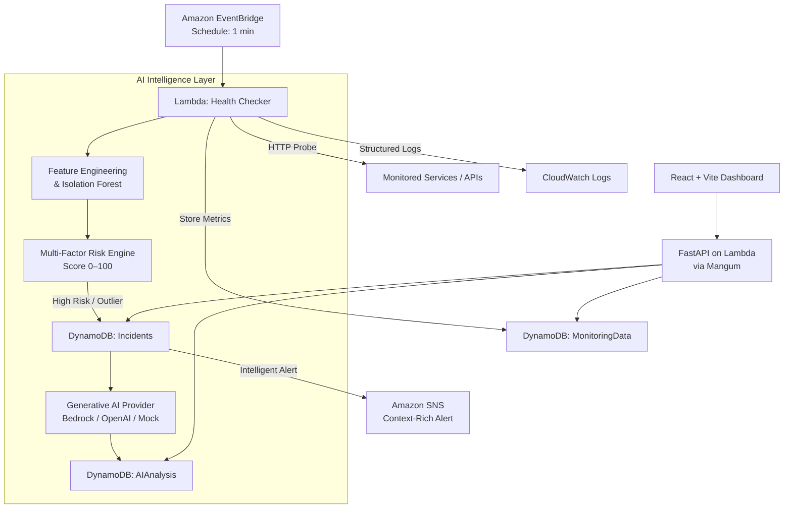

# Intelligent Serverless Monitoring System

[](https://aws.amazon.com/serverless/)
[](https://fastapi.tiangolo.com/)
[](https://vitejs.dev/)
[](https://scikit-learn.org/)

An enterprise-grade, cloud-native serverless monitoring platform that extends traditional uptime checks with **Unsupervised Machine Learning Anomaly Detection (Isolation Forest)** and **Generative AI Root-Cause Explainability**.

---

## 🏛️ Architecture Overview

The system extends the standard **EventBridge → Lambda → DynamoDB → CloudWatch → SNS** monitoring pipeline with an intelligent AI layer:



---

## 🌟 Key Features

1. **Serverless Health Checker**: High-throughput, distributed HTTP/HTTPS health checks scheduled via Amazon EventBridge.
2. **Isolation Forest Anomaly Detection**: Unsupervised multi-dimensional detection of subtle latency degradation, jitter, and abnormal error rate distribution without requiring labeled training datasets.
3. **Multi-Factor Risk Scoring Engine**: Calculates predictive risk scores (0–100) combining threshold breaches, historical standard deviations, error spikes, and status code shifts.
4. **Explainable AI Root-Cause Analysis**: Generates natural language incident summaries, observed telemetry facts, probable architectural causes, and step-by-step remediation plans.
5. **Interactive SRE AI Assistant**: Natural language chat interface answering real-time telemetry queries and diagnosing operational bottlenecks.
6. **Modern Dark Glassmorphic Dashboard**: Real-time telemetry charts, live on-demand checks, incident triage, and service management.
7. **Graceful Degradation & Cost Optimization**: Monitoring continues seamlessly even if AI services fail; LLM calls are cost-optimized to trigger only on significant anomalies.

---

## 📁 Repository Structure

```
├── backend/
│   ├── ai/                      # LLM Provider abstraction & prompt engineering
│   ├── api/                     # FastAPI route handlers & Pydantic schemas
│   ├── database/                # DynamoDB repository implementations
│   ├── lambdas/                 # Lambda functions (HealthChecker, AnomalyDetector, Analyzer)
│   ├── ml/                      # Preprocessing, Isolation Forest training & risk engine
│   ├── utils/                   # Config, JSON logging, input validation
│   ├── requirements.txt         # Backend Python dependencies
│   └── main.py                  # FastAPI application entrypoint & Mangum handler
├── frontend/
│   ├── src/                     # React + Vite application & custom CSS design system
│   ├── package.json             # Frontend Node dependencies
│   └── vite.config.js           # Vite development server & proxy config
├── scripts/
│   ├── seed_data.py             # Realistic telemetry & demo incident seeder
├── tests/                       # Unit and integration tests
├── template.yaml                # AWS SAM Infrastructure as Code template
└── README.md
```

---

## 🚀 Quick Start (Local Development)

### 1. Backend Setup

The assistant uses Groq by default. Copy `.env.example` to `.env`, add your Groq API key as `GROQ_API_KEY`, and keep `AI_PROVIDER=groq`. The configured `openai/gpt-oss-120b` model replaces Groq's retired `llama-3.3-70b-versatile` model. Restart the backend after editing `.env`. In PowerShell, environment variables override `.env`; clear any stale overrides in the backend terminal before restarting:

```powershell
Remove-Item Env:GROQ_API_KEY -ErrorAction SilentlyContinue
Remove-Item Env:GROQ_MODEL -ErrorAction SilentlyContinue
python -m uvicorn backend.main:app --reload --port 8001
```

In local development, the backend automatically checks active services using each service's configured `check_interval`. This starts collecting fresh telemetry as soon as the backend runs. Set `LOCAL_MONITORING_ENABLED=false` in `.env` to disable local checks; deployed AWS monitoring is scheduled by EventBridge.

```bash
# Navigate to project root & create virtual environment
python -m venv venv
venv\Scripts\activate   # (Windows) or source venv/bin/activate (Linux/Mac)

# Install dependencies
pip install -r backend/requirements.txt

# Run FastAPI backend
python -m uvicorn backend.main:app --reload --port 8001
```

FastAPI Swagger Documentation will be accessible at: `http://127.0.0.1:8001/docs`

### 2. Frontend Setup

```bash
cd frontend
npm install
npm run dev
```

Dashboard will be live at: `http://localhost:3000`

### 3. Seed Demo Telemetry & Incidents

In a separate terminal, populate sample services, historical latency series, and an AI-explained incident:

```bash
python scripts/seed_data.py
```

---

## ☁️ AWS Cloud Deployment (SAM)

Deploy the entire serverless infrastructure to AWS using AWS SAM:

```bash
# Build the SAM application
sam build

# Deploy with guided wizard
sam deploy --guided
```

This provisions:
- 4 DynamoDB Tables (`Services`, `MonitoringData`, `Incidents`, `AIAnalysis`)
- 4 Lambda Functions with Least-Privilege IAM Roles
- Amazon EventBridge Scheduled Rule (1-minute invocation)
- Amazon SNS Topic for Intelligent Alerts
- HTTP API Gateway routing to the FastAPI backend

---

## 🧪 Running Tests

```bash
python -m unittest discover tests
```
