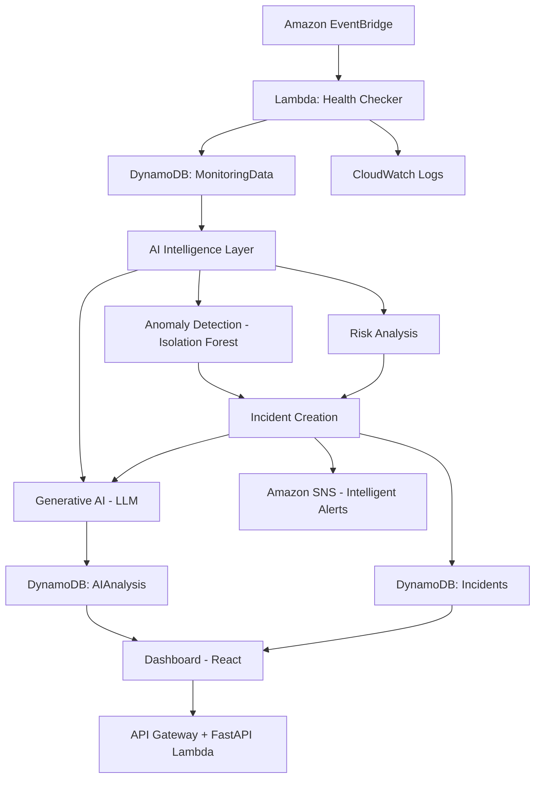

# Implementation Plan — AI-Driven Serverless Event Monitoring System

## Repository Assessment
- **Status**: Empty repository — building from scratch
- **Backend**: FastAPI (as specified by user)
- **Frontend**: React + Vite (modern, fast)
- **Infrastructure**: AWS SAM (template.yaml)

## Architecture Overview

## Phase Breakdown

### Phase 1: Project Scaffolding & Core Monitoring
- Project structure with all directories
- FastAPI backend setup with Lambda adapter
- DynamoDB table definitions (MonitoringData, AIAnalysis, Incidents, Services)
- Health checker Lambda
- Service registration API
- Basic SNS alerting

### Phase 2: Enhanced Monitoring Records
- Rich health check data (response_time, status_code, error_rate, availability, timeout)
- DynamoDB repository layer
- CloudWatch logging integration

### Phase 3: ML Pipeline
- Data preprocessing module
- Isolation Forest training
- Anomaly prediction
- Model persistence (S3)
- Anomaly detector Lambda

### Phase 4: Risk Analysis & Incident Detection
- Risk scoring engine (0-100 scale)
- Incident creation logic
- Incident repository

### Phase 5: Generative AI Integration
- AI provider abstraction (OpenAI, AWS Bedrock)
- Structured prompt system
- Incident analysis pipeline
- AI analysis storage

### Phase 6: Dashboard & Frontend
- React + Vite setup
- Dashboard overview
- Service monitoring pages
- Incident pages with AI analysis
- AI monitoring assistant
- Charts (response time, availability, error rate, risk trends)

### Phase 7: SNS Intelligent Alerts
- Enhanced SNS notifications with AI context
- Alert formatting

### Phase 8: Infrastructure & Deployment
- SAM template
- API Gateway configuration
- EventBridge rules
- IAM policies
- Environment configuration

### Phase 9: Testing & Documentation
- Unit tests for all modules
- Integration tests
- Complete README
- Architecture docs
- API docs
- Deployment guide

## Key Design Decisions
1. **FastAPI on Lambda** via Mangum adapter — serverless but full-featured API
2. **Isolation Forest** for anomaly detection — no labeled data needed
3. **Provider pattern** for LLM integration — swap providers via env var
4. **Separate DynamoDB tables** for monitoring data, AI analysis, incidents, and services
5. **Cost-optimized** — LLM only called for HIGH/CRITICAL incidents
6. **Graceful degradation** — monitoring continues even if AI layer fails
