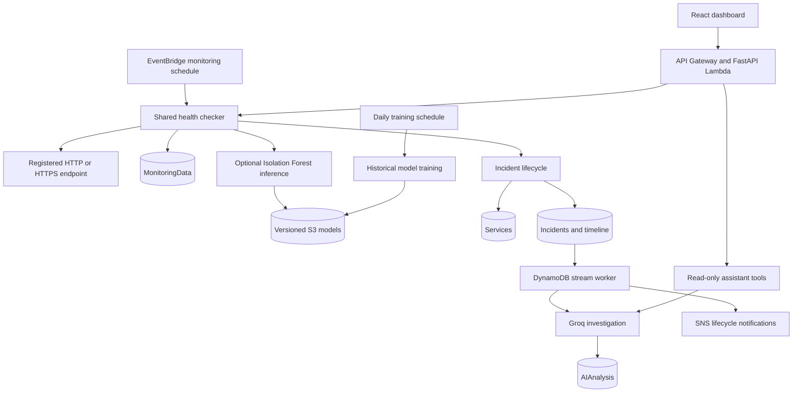

# Intelligent Serverless Monitoring System (ISMS)

Project report covering the existing system, implemented improvements, problems addressed, distinguishing features, and a five-person division of work.

This report reflects the source code and repository verification records available on 9 November 2026. "Existing system" means the earlier implementation recorded in [AUDIT.md](AUDIT.md); "current system" means the upgraded implementation. Test and deployment results below are attributed to existing records, rather than presented as newly executed checks.

## 1. Project overview

ISMS monitors HTTP and HTTPS services and helps an operator investigate and manage their failures. It periodically checks registered endpoints, stores measured observations, detects sustained failure or degradation, maintains an incident history, and verifies recovery. Optional Isolation Forest models identify unusual observations, while a Groq-powered investigation layer explains the available evidence and suggests diagnostic steps.

The application combines a React dashboard, a FastAPI backend, AWS Lambda execution, DynamoDB storage, EventBridge scheduling, SNS notifications, S3 model storage, and CloudWatch platform monitoring. Local development uses SQLite and an in-process monitoring scheduler.

The intended users are small engineering teams, administrators, and project demonstrators who need a connected workflow from an endpoint failure to investigation and verified recovery.

## 2. What problem does the project solve?

### 2.1 Detecting unavailable or slow endpoints

A service can fail through an unexpected HTTP status, a timeout, DNS resolution failure, a connection problem, or a TLS error. A successful response can also arrive too slowly. ISMS records these outcomes and their timestamps so an operator can distinguish availability problems from latency degradation.

### 2.2 Reducing repeated alerts and premature recovery

One failed request may be temporary. Repeated alerts for the same outage create noise, while closing an incident after one successful request can hide an intermittent problem. ISMS tracks consecutive failures and clean checks, keeps one active incident for the failure episode, and requires the configured recovery evidence before resolution.

### 2.3 Bringing investigation context into one workflow

A raw error code leaves the operator to assemble the surrounding history. ISMS connects recent probe results, incident history, declared dependencies, detection evidence, and a timeline. Groq uses that evidence to produce an investigation with observed facts, possible causes, impact, and suggested checks.

### 2.4 Recognizing behavior that simple thresholds can miss

A fixed latency limit does not describe every service's normal behavior. The optional Isolation Forest model adds evidence about observations that differ from the service's learned history. Sustained deviations can contribute to an incident. This detects unusual observed behavior; it does not establish that the system can forecast future outages.

### 2.5 Making operator actions traceable

ISMS records acknowledgement, investigation, mitigation, comments, timestamps, and the authenticated actor. Operators can retry a check or temporarily mute notifications through predefined actions. This provides a response history alongside the monitoring evidence.

### 2.6 Running monitoring without a dedicated monitoring server

The AWS implementation uses scheduled and event-driven functions, managed storage, and bounded data retention. This suits a small deployment that needs monitoring without maintaining a continuously running backend server. Actual operating cost depends on usage, retention, and external AI calls; the project does not establish a universal cost saving.

## 3. Existing system before the upgrade

### 3.1 Original architecture and working features

The project already contained the main application framework:

- A React/Vite dashboard for service registration, status viewing, charts, incident viewing, model retraining, and AI interaction.
- FastAPI REST routes served through API Gateway and the Mangum Lambda adapter.
- Four DynamoDB tables: `Services`, `MonitoringData`, `Incidents`, and `AIAnalysis`.
- An EventBridge-triggered health-check Lambda that performed real HTTP probes.
- Isolation Forest training/inference code and a heuristic risk-scoring engine.
- A real Groq provider integration and structured logging.
- An SNS topic, local periodic monitoring, and a JSON-file development storage adapter.

The upgrade therefore extends an existing monitoring application. It preserves its main framework, model family, and four-table architecture.

### 3.2 Limitations found in the original implementation

| Area | Earlier behavior or gap | Practical consequence |
|---|---|---|
| Scheduling | The scheduled checker ignored individual service intervals | Configured service cadence was not respected |
| Incident consistency | Deduplication depended on a limited, eventually consistent lookup | An outage could be handled inconsistently, including an incorrect resolution path |
| Recovery | A single successful observation could resolve an incident | Intermittent failures could appear resolved too early |
| Operator updates | Incident PATCH passed an unsupported repository argument | Incident response actions could fail |
| Background processing | Standalone anomaly and incident-analysis functions had no SAM triggers | Deployed functions did not form a connected automatic workflow |
| Retraining | Retraining could insert random baseline samples into monitoring storage | Training data and recorded observations could become misleading |
| Model persistence | Model files were local to a Lambda environment | Other functions and fresh execution environments lacked a shared durable model |
| AI context | Chat relied on latest samples and limited incident history | Historical counts and trend questions lacked sufficient evidence |
| Notifications | Publishing mainly covered incident creation | Recovery, escalation, delivery history, and muting were incomplete |
| Local storage | JSON adapter keys, conditions, filters, and updates differed from DynamoDB | Local behavior could overwrite data or hide failures |
| API access | Administrative operations were public; CORS was overly broad | Configuration and incident actions lacked effective access control |
| Dashboard | Fetch failures could look like empty results; HTTP errors could be labeled ML anomalies | Operators could misunderstand missing data or detection provenance |
| Operational context | Connected dependencies, SLOs, timelines, audited actions, and platform alarms were missing | Investigation and platform diagnosis required more manual work |

These findings are specific to this repository's earlier implementation. They are not claims that other monitoring products lack equivalent capabilities. See [AUDIT.md](AUDIT.md) for the original execution-path analysis.

## 4. What has been implemented now?

### 4.1 One monitoring pipeline for manual and scheduled checks

Both invocation paths use the canonical health checker in `backend/lambdas/health_checker/handler.py`. It checks whether a scheduled service is due, acquires a per-service lease, validates the target, performs a real probe, reads prior observations, optionally runs ML, stores the result, and updates the lifecycle.

Probe handling distinguishes HTTP status mismatch, timeout, DNS, connection, and TLS failures. Target validation pins the validated address, keeps TLS verification enabled, restricts methods to GET/HEAD, and prevents redirect-based target changes. Private targets require an explicit development-only setting. Monitoring records include retention TTL values.

### 4.2 Stateful incident detection and verified recovery

`backend/lifecycle.py` tracks consecutive failures, clean checks, sustained degradation, and recent measured errors. A consistent active-incident pointer, per-service leases, conditional writes, and timestamp checks support deduplication and replay handling.

Repeated failures update the active incident. A clean check enters recovery pending; sufficient clean checks resolve it. A relapse returns to the existing incident. The system records observed downtime, severity, detector provenance, metric snapshots, and timeline events. Acknowledging an incident does not mark the endpoint healthy, and an operator cannot manually bypass recovery verification.

### 4.3 Real historical ML training and durable model versions

The retained Isolation Forest now trains on validated service observations from a 72-hour history window. Training excludes synthetic records, removes duplicate timestamps, and requires at least 20 valid samples.

Its ten features are response time, error rate, availability, normalized status code, timeout, request success, prior rolling response time, response-time change ratio, prior rolling error rate, and error-rate change ratio. Historical baselines exclude the observation being evaluated.

Training uses a chronological split: the first 80%, with at least 16 samples, trains the candidate; the remainder provides holdout diagnostics. Nonfinite results or a holdout outlier rate of at least 90% reject promotion. These unlabeled diagnostics do not measure prediction accuracy.

Versioned artifacts include feature schema, checksum, runtime metadata, training time, sample count, threshold, and evaluation results. AWS stores them in S3 and publishes the active pointer after successful preparation. Failed retraining preserves the previous active model. Manual retraining and a daily training worker are connected; inference happens in the health checker. Missing models and inference failures have explicit states, and deterministic monitoring continues.

### 4.4 Evidence-based AI investigation and assistant

The incident stream worker retrieves the incident snapshot, recent observations, detection provenance, model version where available, dependency status, nearby incidents, and timeline before requesting Groq analysis. Structured results separate observed facts from possible causes and diagnostic recommendations.

The assistant uses read-only tools to retrieve services, metrics, incidents, anomalies, dependencies, and failures. Backend facts supply numerical values, counts, and rankings. Groq selects known fact IDs; the renderer validates those IDs and renders measurements from backend results. Provider failures and unavailable evidence are visible.

Application logs, deployment events, and database telemetry have no ingestion pipeline in this implementation. AI output identifies that missing context. AI cannot execute arbitrary commands or independently select remediation actions.

### 4.5 Lifecycle notifications

The incident worker supports creation, critical escalation, sustained-outage escalation, and recovery notifications through SNS. It records publish attempts/history and supports duplicate suppression, cooldowns, muting, and retry handling. Alert publishing operates independently of AI completion.

SAM supports an optional email subscription. A successful SNS publish proves message acceptance by SNS; confirmed subscription and inbox receipt require separate verification.

### 4.6 Reliability, dependency analysis, and operator actions

The operations layer calculates probe-based availability, error rates, latency percentiles, error budgets, SLO status, and observed MTTR/MTBF where sufficient evidence exists. Missing or insufficient data remains explicit. These statistics describe sampled probes rather than all customer requests.

Declared service dependencies are validated for cycles and traversed to show unhealthy dependencies and potentially affected downstream services. Correlation joins monitoring and lifecycle events into an investigation timeline. Dependency relationships and temporal proximity support hypotheses without proving causation.

Authenticated operators can acknowledge, investigate, and mark mitigation progress. Predefined runbooks allow a health-check retry, a one-hour alert mute, and unmuting. Actions record actor, time, comments, and outcome.

### 4.7 Connected frontend

The React dashboard connects service registration, status summaries, metric charts, incident operations, persisted AI investigation, assistant chat, model metadata/retraining, reliability statistics, dependencies, and timelines to backend APIs.

The API client accepts a configurable backend origin and administrator token. Fetch errors are visible, and unavailable model/data states are distinguished from healthy measurements. HTTP failures and ML anomalies have separate meanings in the UI.

### 4.8 Storage, security, deployment, and verification

Local development now explicitly uses SQLite with atomic conditional writes. A migration script preserves access to the older JSON data. Production database failures surface as platform errors instead of silently selecting local storage.

Production APIs require a managed administrator bearer credential. The implementation adds configured CORS origins, secret references, request bounds, target validation, secret sanitization, and resource-scoped IAM permissions.

AWS SAM connects monitoring schedules, daily training, the incident stream worker, durable models, a shared Python dependency layer, CloudWatch logs/alarms, and an SQS failure destination. CI configuration covers backend tests, frontend build, SAM validation, and SAM build. A controlled demo endpoint produces actual healthy, HTTP 500, HTTP 503, timeout, slow-response, and recovery behavior.

## 5. Current architecture and example workflow

For a service configured with a failure threshold of three and a recovery threshold of two:

1. Healthy probes establish measured history. If sufficient valid history exists, an operator or training worker can train a model.
2. The endpoint begins returning HTTP 503. The first two failed probes mark suspected failure.
3. The third consecutive failure creates one confirmed incident with evidence and severity. Further failures update that incident.
4. The incident stream worker publishes the creation notification and requests a Groq investigation. An operator can acknowledge and investigate through the dashboard.
5. A first clean, nondegraded check enters recovery pending. A second resolves the incident and records downtime; recovery notification follows.
6. A failure before verified recovery retains the active incident and records the relapse.

This outage sequence relies on deterministic observations. ML adds anomaly evidence when a model exists; Groq adds investigation context when the provider is available.

## 6. What is unique about this project?

The distinguishing contribution is how the project connects monitoring, ML evidence, AI investigation, and controlled response within a small serverless application. It does not claim a new anomaly-detection algorithm or an industry-first monitoring feature.

| Distinguishing feature | Concrete implementation | Value to the operator |
|---|---|---|
| Separate rules, ML, and AI | HTTP/network observations, Isolation Forest scores, and Groq hypotheses retain separate provenance | An operator can tell what was measured, inferred, or suggested |
| Verifiable assistant measurements | Read-only retrieval, backend-generated facts, and validated fact IDs | Historical answers can be traced to retrieved evidence |
| Complete failure-to-recovery workflow | Sustained detection, one active incident, operator states, recovery checks, and timeline | The same record supports detection, response, and recovery review |
| Inspectable model lifecycle | Real history, holdout diagnostics, immutable S3 artifacts, checksums, and cold-start loading | Retraining and the model used for inference can be audited |
| Dependency context | Declared graph, cycle validation, affected-service traversal, and event correlation | Operators can prioritize potentially related services |
| Controlled response | Authenticated predefined actions and audit history | Useful actions are available without granting AI arbitrary execution |
| Demonstrable behavior | A real HTTP failure simulator exercises the production monitoring path | Demonstrations show actual probe and incident behavior |
| Monitoring independent of AI availability | Rules continue when a model is missing or Groq fails | Core outage detection does not require successful AI inference |

## 7. Division of work into exactly five roles

The following is a proposed five-person ownership split mapped to implemented work and repository files. It describes concrete responsibilities and deliverables; contributor identities and individual authorship were not supplied and cannot be established from this mapping.

### Role 1: Machine Learning and AI Engineer

**Responsibility:** Convert monitoring history into anomaly evidence and evidence-based AI investigations.

Work mapped to this role:

1. Prepare and validate historical observations, normalize status codes, and construct the ten model features using prior-only baselines.
2. Implement Isolation Forest training with minimum-data checks, chronological validation, candidate rejection, and repeatable random seed.
3. Implement inference, anomaly-score mapping, explicit missing-model behavior, and failure isolation from deterministic monitoring.
4. Manage artifact serialization, version/schema/checksum metadata, model loading, active-pointer promotion, and preservation of the previous model after failed retraining.
5. Connect manual retraining and daily historical training logic; expose model metadata and training attempts through the backend contract.
6. Build Groq provider calls, bounded structured prompts, incident evidence assembly, and explicit unavailable-analysis behavior.
7. Implement assistant retrieval tools, known-fact selection/validation, backend numerical rendering, and separation of hypotheses from facts.

**Primary files:** `backend/ml/`, `backend/ai/`, `backend/lambdas/anomaly_detector/handler.py`, AI logic in `backend/api/routes/ai.py`, [ML.md](ML.md), and [AI.md](AI.md).

**Deliverables:** Working training/inference pipeline, inspectable model artifacts, evidence-based incident analysis, and grounded assistant responses.

**Handoff:** Provides model and AI result contracts to Backend; works with Deployment on S3/runtime/secret configuration and Testing on inference, validation, and grounding checks.

### Role 2: Deployment and Cloud Engineer

**Responsibility:** Package, deploy, and observe the application on AWS.

Work mapped to this role:

1. Maintain SAM resources for API Gateway, Lambda, the four DynamoDB tables, EventBridge, SNS, S3 model storage, managed secrets, and SQS failure retention.
2. Connect the monitoring schedule, daily training schedule, incident stream trigger, optional demo function, and optional SNS email subscription.
3. Configure per-function permissions, secret references, CORS parameters, log retention, platform metrics, and alarms.
4. Build the shared Linux Python dependency layer, prune unused package content, enforce package-size budgets, and verify imports/inference from deployable artifacts.
5. Support repeatable Python 3.11 container builds and AWS deployment in `ap-south-2`, preserving existing tables and upgrade compatibility.
6. Maintain CI build/deployment validation configuration and resolve deployment-specific IAM, log-group, concurrency, and packaging issues.
7. Configure the frontend build's API origin and document hosting/deployment steps. Public frontend hosting remains pending in the recorded acceptance status.

**Primary files:** `template.yaml`, `backend/Makefile`, `backend/build_package.py`, `backend/requirements-lambda.txt`, `Dockerfile.test`, `scripts/prepare_build.py`, `scripts/prepare_cloud_template.py`, `scripts/verify_build.py`, `.github/workflows/verify.yml`, and [DEPLOYMENT.md](DEPLOYMENT.md).

**Deliverables:** Deployable SAM stack, compatible Lambda artifacts, cloud permissions/secrets, connected triggers, observability, and deployment instructions.

**Handoff:** Supplies runtime configuration and API endpoint to Backend/Frontend; coordinates with ML on shared model access and Testing on cloud acceptance evidence.

### Role 3: Frontend Engineer

**Responsibility:** Make monitoring evidence and operator workflows accessible through the dashboard.

Work mapped to this role:

1. Build the React application shell, navigation, service registration form, service list, and overview cards.
2. Connect metrics charts and service-detail views to real persisted observations, reliability statistics, and model metadata.
3. Implement incident lists and detail views with severity, detection source, acknowledgement, investigation, mitigation, recovery, and timeline information.
4. Connect the AI investigation drawer and assistant modal to the backend, including persisted results and unavailable/error states.
5. Present dependency relationships, potentially affected services, notification information, and predefined operator actions through the operations panel.
6. Implement the shared API client with configurable origin, administrator-token handling, and visible request failures.
7. Maintain responsive styling and labels that distinguish HTTP failure, ML anomaly, unknown data, and recovery pending.

**Primary files:** `frontend/src/App.jsx`, `frontend/src/components/`, `frontend/src/services/api.js`, `frontend/src/index.css`, `frontend/vite.config.js`, and `frontend/package.json`.

**Deliverables:** API-connected dashboard, service/incident workflows, charts, AI views, and production frontend build.

**Handoff:** Consumes Backend API contracts and Deployment configuration; works with Testing on UI scenarios. A successful build and HTTP serving are recorded, while visual browser acceptance remains pending.

### Role 4: Backend Engineer

**Responsibility:** Implement authoritative monitoring behavior, APIs, persistence, and incident operations.

Work mapped to this role:

1. Build FastAPI routes and schemas for service CRUD, monitoring history, manual checks, incidents, metrics, AI access, and operations.
2. Implement the canonical HTTP checker, individual service cadence, network/error classification, target validation, timestamped observations, and telemetry retention.
3. Implement lifecycle thresholds, sustained degradation/error handling, incident deduplication, verified recovery, observed downtime, and audited operator transitions.
4. Maintain DynamoDB repositories, Decimal serialization, pagination, conditional writes, service leases, active-incident pointers, and explicit SQLite development persistence.
5. Connect incident stream processing to analysis persistence and SNS lifecycle notifications, including publish history, escalation, muting, and retries.
6. Implement probe-based reliability/SLO calculations, dependency validation/traversal, and correlation timelines.
7. Enforce administrator authorization, request validation, actor attribution, and predefined runbook execution.
8. Implement controlled demo HTTP responses, local monitoring startup, and migration/support utilities.

**Primary files:** `backend/main.py`, `backend/api/`, `backend/database/`, `backend/lambdas/health_checker/handler.py`, `backend/lambdas/incident_analyzer/handler.py`, `backend/lifecycle.py`, `backend/operations.py`, `backend/notifications.py`, `backend/utils/`, and `backend/demo.py`.

**Deliverables:** Working REST API, durable monitoring records, consistent incident lifecycle, notification orchestration, reliability/dependency services, and audited operations.

**Handoff:** Defines API/evidence contracts for Frontend and ML, and works with Deployment on triggers, storage permissions, configuration, and runtime behavior.

### Role 5: Testing, Security, and Integration Engineer

**Responsibility:** Verify that the components work together and that reported capabilities match evidence.

Work mapped to this role:

1. Maintain isolated pytest fixtures and regression coverage for APIs, configuration, storage, lifecycle behavior, and risk analysis.
2. Verify actual HTTP/network outcome classification, consecutive-failure handling, deduplication, replay/concurrency handling, relapse, and clean-check recovery.
3. Verify real model fitting/inference, rejection of fake or insufficient training data, failed-candidate preservation, and S3 cold-cache loading.
4. Test assistant fact validation, unsupported measurements, provider-unavailable states, and separation of deterministic evidence from AI hypotheses.
5. Test authorization/CORS, input and target validation, dependency cycles, predefined-action restrictions, notification cooldown/escalation/recovery, and surfaced platform failures.
6. Maintain an end-to-end scenario using a real local HTTP server and the live demo script; distinguish mocked provider tests from actual Groq/AWS verification.
7. Review frontend build results, SAM validation, deployable artifact checks, and dependency-audit evidence with the component owners.
8. Maintain audit/change/verification records and track pending acceptance work, including inbox delivery, browser interaction, public hosting, and unexercised cloud failure paths.

**Primary files:** `tests/`, `tests/conftest.py`, `scripts/demo.py`, verification configuration in `.github/workflows/verify.yml`, [TESTING.md](TESTING.md), [AUDIT.md](AUDIT.md), [CHANGES.md](CHANGES.md), and [OPERATIONS.md](OPERATIONS.md).

**Deliverables:** Regression and integration evidence, security checks, a reproducible demonstration, and an accurate acceptance report.

**Handoff:** Defines acceptance scenarios with all four implementation roles, reports defects to their owners, and records which checks passed or remain pending. Security implementation remains shared with Backend and Deployment.

### Five-role summary

| Role | Main question answered | Main output |
|---|---|---|
| ML and AI | Is this observation unusual, and what does the evidence suggest investigating? | Model pipeline, version metadata, AI analysis, grounded assistant |
| Deployment and Cloud | How does the application run reliably on AWS? | Infrastructure, builds, triggers, permissions, secrets, alarms |
| Frontend | How does an operator view evidence and respond? | Dashboard, charts, forms, incident/AI/operations views |
| Backend | How are checks, data, incidents, and actions processed consistently? | APIs, repositories, lifecycle, notifications, operational calculations |
| Testing, Security, and Integration | What evidence shows the complete system works within its limits? | Automated checks, integration scenarios, acceptance and limitation records |

## 8. Recorded verification and remaining work

According to [TESTING.md](TESTING.md), the repository records the following completed verification:

- 54 automated tests passed in the Linux Python 3.11 runtime, covering backend, storage, ML, lifecycle, operations, grounding, and notifications.
- The frontend production build, SAM validation/container builds, and deployable-package import/inference checks succeeded.
- A live local demonstration exercised actual HTTP failure/recovery and real Groq investigation/assistant calls.
- The existing AWS stack in `ap-south-2` reached `UPDATE_COMPLETE`; recorded cloud acceptance covered authenticated APIs, scheduled monitoring, incident stream processing, Groq responses, SNS creation/recovery publishing, real historical training, and fresh-Lambda model loading from S3.

Remaining acceptance work in that record includes confirmed SNS email subscription/inbox delivery, public frontend hosting, visual browser interaction checks, deliberate discarded-event delivery to SQS, the next daily training schedule occurrence, and execution of the added CI workflow on GitHub.

The current system also has explicit scope limits: it uses a shared administrator identity rather than individual SSO/RBAC; operational queries are capped; reliability is probe-based; dependency correlation does not prove root cause; application-log/deployment-event ingestion is absent; and neither anomaly scores nor heuristic risk scores are calibrated future-outage probabilities.

## 9. Supporting documentation

| Document | Purpose |
|---|---|
| [README.md](README.md) | Current overview and startup instructions |
| [PROJECT_GUIDE.md](PROJECT_GUIDE.md) | Extended guide, including clearly marked historical material |
| [AUDIT.md](AUDIT.md) | Earlier implementation and original gaps |
| [CHANGES.md](CHANGES.md) | Implemented changes and file-level evidence |
| [ARCHITECTURE.md](ARCHITECTURE.md) | Current architecture and lifecycle |
| [API.md](API.md) | Routes, authorization, payloads, and query limits |
| [ML.md](ML.md) / [AI.md](AI.md) | Model pipeline, evidence grounding, and statistical/provider limits |
| [DEPLOYMENT.md](DEPLOYMENT.md) / [OPERATIONS.md](OPERATIONS.md) | Cloud setup, demonstration, and troubleshooting |
| [TESTING.md](TESTING.md) | Recorded verification and pending acceptance |
